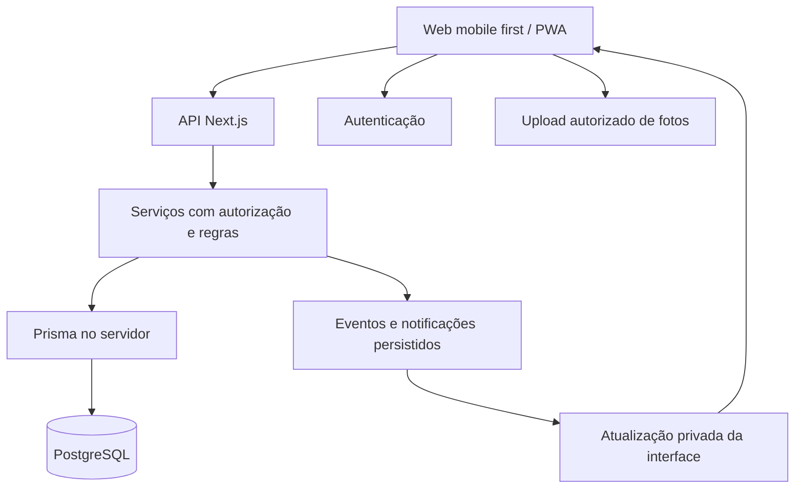

# Meu Mimo — proposta técnica e decisões de dados

Atualizado em 22 de outubro de 2026. Complementa `design.md` e `requisitos.md`.
Registra decisões, propostas futuras e o escopo local de T01–T09. D07 e D08
foram confirmadas em T06; T07 integra a origem de conquistas.

## 1. Decisões e base da implementação

**Confirmado pelo idealizador:** aplicação mobile first, Prisma para migrações de estrutura do banco, histórico de pontos e resgates no MVP, várias fotos/vídeos publicados pelo lojista em cada resgate e retrospectiva futura no estilo de apresentação do Spotify Wrapped.

Interpretação adotada para “Prisma DB para migração”: **Prisma ORM e suas ferramentas de migração sobre PostgreSQL**.

**D01 confirmada pelo idealizador em M0, em 22/10/2026:** Next.js/React/TypeScript em `web/`, PostgreSQL com Prisma e Supabase para Auth/Storage, com desenvolvimento e testes locais. Essa confirmação não contrata serviços nem autoriza publicação. **D02 confirmada em T02:** e-mail/senha com e-mail verificado, recuperação, retorno seguro ao convite e MFA/TOTP obrigatório para administração provisionada separadamente. A preparação local, D03, D04 de autenticação/T04/T07/T08, D05 e D07/D08 foram autorizados. As propostas restantes estão discriminadas em requisitos §6.1.

| Camada | Seleção e estado | Responsabilidade |
|---|---|---|
| Aplicação | Next.js, React e TypeScript; confirmados em D01 | Web, API e serviços da aplicação |
| Interface | Tailwind CSS e CSS com tokens semânticos; cinco componentes próprios em T03, sem pacote adicional | Adaptar identidade, composição e assets do protótipo |
| Banco | PostgreSQL 17.11 na stack Supabase local de T02 | Persistência relacional e transações |
| Acesso e migrações | Prisma ORM e migrações versionadas; confirmados | Modelos, consultas e evolução do banco |
| Identidade | Supabase Auth local em T02, com e-mail/senha, verificação, recuperação e MFA administrativo | Autenticação e sessões |
| Fotos e vídeos | Supabase Storage privado; D07 e processo local separado confirmados em T06 | Upload retomável, derivados e consulta reautorizada |
| Eventos ao vivo | Supabase Realtime com audiência autorizada; proposta para T05 | Avisar a interface sobre mudanças confirmadas |
| Qualidade | Validação de entrada, testes de regras, integração e navegação; requisito | Cobrir autorização, concorrência e uso pelo celular |
| Publicação | Vercel; opção futura, sem implantação autorizada | Hospedar a aplicação Next.js |

Fixar versões estáveis e compatíveis no início da implementação. As interfaces e comandos do Prisma variam entre versões; os comandos operacionais devem ser registrados para a versão escolhida, sem depender de uma instalação implícita de `latest`.

T03 acrescenta `Button`, `Input`, `Dialog`, `StatusBadge` e `PointsSummary` em
`web/src/components/ui/`. O diálogo usa o elemento nativo, estado controlado,
contenção de Tab e retorno do foco ao acionador. Para este escopo, shadcn/ui
não justificou uma dependência adicional. Os contratos estão no
[registro de T03](docs/superpowers/plans/2026-10-22-t03-interface.md).
Fontes DM Sans/DM Serif são locais, com licença, `font-display: swap` e
alternativas. `/visual-check` usa somente dados fictícios em memória, sem
serviços ou persistência; P01/L02 com dados autorizados continuam em T12.

### 1.1. Seleções técnicas de M0

Versões selecionadas em 22/10/2026 por consulta ao registro npm oficial.
Os pacotes de T01/T02 estão declarados e fixados em `web/package-lock.json`.

| Grupo | Versões exatas selecionadas | Etapa |
|---|---|---|
| Runtime preservado | Node.js 24.12.0, npm 11.19.1 | Já existente; mínimo `>=24.12.0 <25` |
| Aplicação | `next` e `eslint-config-next` 16.4.2; `react` e `react-dom` 19.3.1 | T01 |
| Tipagem | `typescript` 6.0.3; `@types/node` 24.19.2; `@types/react` e `@types/react-dom` 19.3.0 | T01 |
| Lint de `web/` | `eslint` e `@eslint/js` 9.39.5; `globals` 16.4.0; `typescript-eslint` 8.72.0 | T01; raiz preserva ESLint 10.13.0 |
| CSS | `tailwindcss` e `@tailwindcss/postcss` 4.3.3; `postcss` 8.5.23 | T01 |
| Navegação automatizada | `@playwright/test` 1.64.1 | T01/T03 |
| Banco | `prisma`, `@prisma/client` e `@prisma/adapter-pg` 7.10.1; `pg` e `@types/pg` 8.23.1 | T02 |
| Identidade | `@supabase/supabase-js` 2.118.0; `@supabase/ssr` 0.12.7 | T02 |
| Ferramentas de servidor/local | `server-only` 0.0.1 em T01; `dotenv` 18.0.8 e CLI `supabase` 2.121.0 em T02 | Instalar apenas na etapa que precisar |

Escolhas do orquestrador: TypeScript 6.0.3 respeita o intervalo declarado por `typescript-eslint` (`>=4.8.4 <6.1.0`), enquanto TypeScript 7.0.2 está fora dele. A CLI Prisma em `latest` apontava para `8.0.0-rc.25`; a linha 7.10.1 mantém CLI, cliente e adaptador alinhados em versões estáveis. Plugins React/import/acessibilidade usados pelo preset Next ainda declaram ESLint 9, razão para isolar o lint de `web/` sem alterar o lint atual nem usar instalação forçada.

O ensaio `npm install --dry-run --ignore-scripts --no-audit --no-fund --package-lock=false` resolveu a árvore de aplicação/banco/testes em diretório descartável ignorado, sem instalar pacotes nem criar lockfile. Engines/peers e resolução não comprovam build, execução, segurança ou testes reais: esses aceites pertencem a T01/T02. Os tipos mais recentes da série Node 24 não autorizam depender de APIs posteriores ao runtime mínimo.

Cada pacote npm terá seu lockfile e seus comandos. A raiz continuará atendendo a demonstração em 4173; a nova aplicação usará 4301. Lint, tipos e build executam em série no mesmo checkout. T02/T03 também ficam em série por padrão, pois portas e `distDir` distintos não isolam fontes, `next-env.d.ts` e arquivos incrementais. O plano concreto está em [M0 e fundação](docs/superpowers/plans/2026-10-22-m0-fundacao.md).

Fontes: [registro npm](https://registry.npmjs.org/), [instalação do Next](https://nextjs.org/docs/app/getting-started/installation), [CLI e geração de tipos](https://nextjs.org/docs/app/api-reference/cli/next), [Prisma Migrate v7](https://www.prisma.io/docs/orm/v7/prisma-migrate/workflows/development-and-production), [Supabase com Prisma](https://supabase.com/docs/guides/database/prisma) e [Supabase local](https://supabase.com/docs/guides/local-development/cli/getting-started). Context7 foi consultado para Next, Prisma e Supabase; a documentação versionada do Prisma v7 prevalece sobre páginas genéricas que já descrevem outra linha.

### 1.2. Lojas e convites em T04

D03 e os limites D04 aplicáveis foram confirmados em 22/10/2026, conforme
`requisitos.md`, seção 6.1. T04 acrescenta criação e edição de lojas, vínculo
único por conta/loja, um responsável por loja, convite portador revogável com
sete dias, perfil próprio e estados de pausa/encerramento. O domínio usa Prisma
e credencial restrita; o Auth preserva a fundação T02. Os
[comandos e recursos locais](docs/stores-local.md) separam os bancos de domínio,
desenvolvimento, shadow e Auth.

`StoreAudit` registra ações com autor e instante. Token de convite fica em hash;
HMAC privado e chave de operação permitem recuperar a mesma URL após resposta
perdida. Transações revalidam sessão/perfil e bloqueiam loja antes de vínculo e
convite. Restrições únicas protegem papel e repetição; pausa/revogação/aceite
concorrentes são serializados pelo mesmo bloqueio de loja. Rotação da chave e
limites globais do endpoint público são preparação obrigatória antes de T14.

`Membership.closedAt` preserva leitura histórica; `accessRevokedAt` continua
negando acesso. Não existem registros/tickets/saldo neste pacote. T07–T10 devem
marcar `Store.domainStartedAt` atomicamente na primeira operação, bloquear fuso e
consultar pendências reais antes de encerrar; até essa integração o marcador
impede encerramento por segurança. Não há contadores fictícios de pendências.

### 1.3. Conversas e novidades em T05

O desenho de T05 e comentários privados/imutáveis de até500 caracteres Unicode
foram confirmados em 22/10/2026. Conversation associa assunto tipado de registro
ou ticket a uma participação; Comment tem autor/instante e UUID de repetição.
O registro da conversa é interno e usa a mesma transação do recurso de origem,
integrado por T07/T09. Não há endpoint público para criar assunto solto.
Fechamento preserva consulta e a conversa necessária a pendências; revogação
continua negando acesso. A origem define commentsClosedAt para fechar escrita.

OutboxEvent é persistido na transação do produtor. Convite aceito é o primeiro
produtor real de T04; comentários também geram evento para a outra pessoa.
Notification tem evento único e leitura independente. O consumidor PostgreSQL
bloqueia evento com SKIP LOCKED, insere aviso e confirma processamento na mesma
transação; rollback permite retomada sem posse fora da transação. Repetição e
consumidores concorrentes não duplicam aviso. Falhas recebem retry/backoff e
código sanitizado, sem texto do comentário ou token no diagnóstico.

As consultas revalidam destinatário, vínculos e recurso; a ordenação pela
entrega recupera eventos antigos processados mais tarde. Destinos são tipados e
derivados; T07/T09 integram as telas reais de registro/ticket. Realtime é
opcional e não foi necessário ao consumidor SQL; central/preferências e demais
interações ficam em T12. Comandos e fronteiras em [T05 local](docs/relation-local.md).

### 1.4. Mídia privada em T06

D07/desenho foram aprovados em 22/10/2026: limites em requisitos §6.1.
MediaCollection associa propósito/origem tipada à loja e participação. Evidência
tem uma foto por revisão e preserva as anteriores; memória admite 20 itens.
MediaAsset usa UUID da operação e metadados imutáveis; MediaPart persiste offset,
tamanho e checksum. Registro de coleção, revisão e publicação são internos à
transação da origem, integrada em T07/T08 para evidências; álbuns são T11.

Next mantém credencial restrita e autorização de sessão/contexto. O processo de
mídia em loopback recebe service role separadamente para o bucket privado
reservado; a conexão Prisma desse processo continua restrita. O Storage usa o
banco postgres e não consulta diretamente app em bancos de domínio separados.
Gateway com MAC curto evita supor que prefixos ou token nativo de upload de duas
horas sejam autorização atual. Não se recriam schemas gerenciados do Supabase.

Upload em partes de 5 MiB tem repetição por offset/checksum, com revalidação
antes/depois do Storage. Processamento fora da transação usa lease e confirmação
condicional; Sharp/FFmpeg produzem imagem/miniatura sem localização e MP4
H.264/AAC quando houver áudio. Derivados prontos ainda são rascunhos do autor;
publicação interna libera apenas a audiência da origem. URL própria de 300 s é
vinculada à sessão e GET/Range revalida permissão/estado, sem redirecionamento.

Remoção explícita ou por prazo oculta antes do expurgo, que é idempotente e
reconcilia objetos privados tardios. D08 limpa órfãos após 24h sem atividade e
originais após confirmar os derivados. Evidência publicada tem 180 dias; álbum
tem prazo de 12 meses após encerramento informado pela origem. retentionHold
inicia true: não se infere ausência de análise/contestação. Comandos, versões, credenciais,
limites de formatos e provas móveis em [T06 local](docs/media-local.md).

## 2. Organização da aplicação

- Separar módulos de contas, lojas, participantes, atividades, registros, pontos, mimos, tickets, bilhetes e notificações.
- Executar Prisma somente em ambiente de servidor. Navegador não recebe credenciais de banco.
- Validar sessão, papel, loja e participação antes de consultar ou alterar recursos privados.
- Processar aprovação, resgate e estorno em serviços transacionais. SQL específico é permitido quando necessário para restrições, bloqueios ou funções do PostgreSQL.
- Realtime comunica uma mudança confirmada; a consulta autorizada continua sendo a fonte dos dados. Falha de conexão ou evento perdido é recuperada por nova consulta.
- Upload pode ir diretamente ao Storage com autorização apropriada, evitando transformar a API de aplicação em passagem obrigatória de arquivos grandes.

### 2.1. Prisma e autorização

Uma conexão Prisma ao PostgreSQL não herda automaticamente a identidade do usuário do Supabase Auth. Dependendo do papel da conexão, ela também pode não estar sujeita a RLS. A implementação precisa verificar o modelo de conexão e as permissões efetivas.

Por isso, a autorização da API e os filtros por loja/participação são obrigatórios em consultas Prisma. RLS, grants e políticas do Storage/Realtime complementam a proteção nos caminhos em que se aplicam; não substituem essa validação.

Definir os caminhos públicos de dados explicitamente. Se a aplicação acessa tabelas de negócio apenas pelo backend, restringir a Data API correspondente e impedir escritas diretas do navegador em pontos, tickets e decisões de análise. Canais de Realtime têm autorização própria e não podem expor uma relação a todos os participantes da loja.

## 3. Migrações de estrutura com Prisma

O uso de Prisma para migração foi escolhido; o procedimento abaixo é a proposta operacional:

1. Alterar os modelos do banco no projeto e gerar uma migração em desenvolvimento.
2. Revisar o SQL e seus efeitos em dados existentes, nomes, índices e permissões.
3. Incluir SQL complementar necessário, como políticas RLS e restrições que a modelagem não represente, na mesma cadeia versionada de migrações da aplicação.
4. Testar em banco de desenvolvimento/teste antes de aplicar ao ambiente real.
5. Na publicação, aplicar somente migrações previamente revisadas pelo comando de produção da versão escolhida.
6. Registrar o resultado, verificar compatibilidade entre código e esquema e manter estratégia de recuperação.

Prisma será responsável pela evolução do esquema da aplicação. Esquemas internos gerenciados pelo Supabase, como Auth e Storage, permanecem sob responsabilidade do serviço; não devem ser recriados pelo ORM.

Uma alteração de dados em produção exige preservar o histórico e planejar transformações. Corrigir um lançamento de pontos usa um movimento compensatório do domínio; não é uma migração de esquema.

Para a implantação serverless proposta, definir pooling, orçamento de conexões e conexão apropriada para execução de migrações conforme o provedor e a versão adotados. Credenciais ficam somente nos ambientes autorizados.

Referências técnicas: [Prisma com Supabase](https://supabase.com/docs/guides/database/prisma), [customização de migrações](https://www.prisma.io/docs/orm/v7/prisma-migrate/workflows/customizing-migrations), [desenvolvimento e produção](https://www.prisma.io/docs/orm/v7/prisma-migrate/workflows/development-and-production). As duas últimas descrevem Prisma ORM v7 e precisam ser revalidadas se outra versão for escolhida.

### 3.1. Fundação local e evolução até T09

O schema privado `app` iniciou com Profile, Store, Membership e AdminGrant;
T04 acrescenta os estados de loja/participação, Invitation e StoreAudit; T05,
Conversation, Comment, OutboxEvent e Notification. AuthSession
mantém revogação/contexto restrito, AuthRateBucket persiste a janela atômica
e SecurityAudit registra evento/ator/instante sem senha, token ou e-mail.
T06 acrescenta MediaCollection, MediaAsset e MediaPart. T07 acrescenta Activity,
ActivityEvent, ActivitySubmission, SubmissionEvent e PointsEntry. T08 acrescenta
SubmissionReviewEvent e compensações. As nove migrações em
`web/prisma/migrations/` incluem SQL de permissões; 22 tabelas têm RLS.
Auth/Storage mantêm seus schemas gerenciados pelo Supabase.

Runtime usa `meumimo_runtime`, sem superuser/bypass de RLS ou escrita em
AdminGrant. T04/T05 concedem criação de entidades do domínio e atualização restrita
às colunas do domínio; papel e revogação de acesso não são alteráveis. `anon`/`authenticated` não acessam `app`, que
também fica fora da Data API. RLS restringe o papel de conexão; identidade e
escopo de loja continuam obrigatórios na API Prisma. O pool local usa no
máximo 5 conexões, timeout de conexão 5 s e ociosidade 10 s.

`getUser` e claims verificados, e-mail confirmado, AuthSession ativa e perfil
não suspenso formam a identidade. Cada consulta privada revalida sessão e
permissão. Callback exige contexto HMAC ligado ao verifier PKCE e método AMR
compatível no JWT assinado pelo Auth (`email/signup` ou `recovery`). Sessões
de recuperação só alteram senha/saem; administração exige grant separado e AAL2.
Cookies de renovação são propagados com HttpOnly/SameSite=Lax; respostas
privadas usam no-store. As mutações validam Origin, JSON e corpo limitado.

Stack comprovada: Docker Desktop 4.96.2, engine Linux 29.9.2 e PostgreSQL
17.11 (imagem `public.ecr.aws/supabase/postgres:17.11.0.004`), com Supabase
CLI 2.121.0 e Auth 2.197.0. Desenvolvimento, shadow e
integração usam bancos separados; 54321/54322/54324 estão em loopback.
Configuração, comandos, provisionamento administrativo e limites operacionais
estão em [identidade local](docs/identity-local.md). Nenhuma migração ou
implantação em ambiente real foi executada.

### 3.2. Atividades e crédito inicial em T07

Activity mantém a regra atual e ActivityEvent registra versões/configurações
imutáveis. ActivitySubmission inicia DRAFT privado, com coleção de evidência;
recebimento grava snapshot, data/fuso/período e número de ocorrência. O trigger
de banco impede reescrever esse snapshot. Calendário PostgreSQL usa a primeira
fronteira válida da data local, inclusive meia-noite repetida ou saltada no DST.
Editar frequência conta todos os recebidos no período da regra nova.

O lock compartilhado da loja serializa envio, regra, pausa e encerramento.
Recebimento manual PENDING não credita; AUTOMATIC grava APPROVED, PointsEntry,
SubmissionEvent, conversa, publicação/proteção de evidência e outbox na mesma
transação. Nenhum byte externo é enviado dentro dela. Origem/loja/participação
têm FKs compostas. Ledger e eventos não têm UPDATE/DELETE no papel runtime.
Chave da origem e índice parcial impedem segundo crédito inicial; trigger exige
valor igual aos pontos da origem aprovada. Total usa SUM bigint→texto e chega
como string decimal à interface, que formata com BigInt.

Não há carteira materializada ou endpoint público de crédito. GET do mesmo
registro recupera resposta perdida; replay valida digest e autorização atual
antes de devolver o resultado recebido, mesmo após pausa/alteração de regra.
Rascunho/falha não ocupa ocorrência. Legenda até500 Unicode e foto opcional
READY tornam-se imutáveis; a coleção fecha para upload e remoção genérica da
evidência é recusada. Manual mantém hold; automático aplica os180 dias D08.

Encerramento consulta PENDING real na mesma transação, substituindo a proteção
provisória de T04. Primeiro recebimento marca domainStartedAt e bloqueia fuso.
`SUBMISSION_RECEIVED` e comentários da origem resolvem destino ao registro real
com audiência atual. Conversas recebidas mantêm as regras T05 após encerramento.
Operação de atividades em [T07 local](docs/activities-local.md).

### 3.3. Análise e compensações em T08

D05 foi confirmada: CONTESTED conserva crédito, VOIDED estorna uma vez, e
REOPEN volta a PENDING sem recompor. Aprovar depois recompõe a ponta estornada.
ActivitySubmission.analysisVersion separa análise da versão do snapshot;
SubmissionReviewEvent registra UUID/digest, autor, estados, motivo, resposta,
revisão de evidência e delta. approvedAt conserva a primeira aprovação.

PointsEntry recebe reviewEventId e compensatesEntryId únicos; crédito inicial,
estorno e recomposição formam uma cadeia por origem/loja/participação. FKs
compostas, índice inicial e triggers diferidos exigem evento e alteração da
origem correspondentes, delta igual ao lançamento e crédito consistente com
o estado final. Ledger/auditorias não recebem UPDATE/DELETE no runtime.

O lock da loja serializa também saldo, análise, resposta e encerramento. UUID
é recuperada antes de verificar versão/saldo após autorização atual. Uma prévia
de saldo diferente causa 409. Resposta exige solicitação aberta e texto ou foto
READY da revisão atual; publicação, fechamento de uploads, hold D08 e outbox
pertencem à mesma transação. Pausa permite complementos de origem contestada;
CLOSED permite consulta/replay. Encerramento bloqueia PENDING/CONTESTED.

Histórico une eventos T07/T08. Extrato usa datas inclusivas no fuso atual da
loja, tipo e pessoa; os totais usam SUM→texto/BigInt. Primeiras aprovações e
ajustes diários são separados. Novidades apontam ao evento reautorizado.
Contratos e comandos em [T08 local](docs/points-local.md). Gastos e tickets
integram o mesmo saldo na etapa T09 descrita abaixo.

### 3.4. Catálogo e emissão em T09

D06 e limites do catálogo foram confirmados. Reward guarda a configuração;
RewardEvent audita UUID/digest/versão. stockRevision é separado: consumo muda
quantidade e revisão, sem alterar preço/regra. Edição confirma ambas as versões
e audita a quantidade disponível agora. Catálogo usa stickers locais.

Redemption.id é a UUID da intenção. Código, conteúdo, custo, data/fuso, saldos
e reserva da ocasião são snapshots imutáveis; RedemptionEvent registra emissão.
O lock da loja serializa saldo/estoque/análise/encerramento. Emissão, débito
REDEMPTION_DEBIT, reserva limitada, evento, conversa TICKET e outbox confirmam
na mesma transação. A nova origem de PointsEntry é exclusiva da conquista;
checks explícitos, FKs compostas e triggers preservam as proteções T08.
Reserva limitada exige alteração real na transação e revisão sem auditoria
administrativa; a verificação diferida também impede auditoria inserida depois.

Saldo continua SUM→texto/BigInt. Gasto não altera a cadeia da conquista nem
ganhos/ajustes diários. Anular crédito gasto pode deixar saldo negativo,
preservando o ticket; um novo resgate exige saldo suficiente. Tickets não
bloqueiam encerramento. Replay reautoriza antes de recuperar, inclusive após
pausa/encerramento. UUID não troca autor, loja, mimo ou corpo.

URL contém apenas UUID opaca para recuperar resposta perdida/reload. Consulta
de operação autoriza a origem e retorna ticket ou null; null exige nova prévia
e confirmação da mesma intenção. Nunca persistir saldo/conteúdo em localStorage.
Histórico usa período inclusivo no fuso e audiência atual; contador é separado
dos filtros/página. Avisos/comentários resolvem o ticket real. Contratos e
comandos em [T09 local](docs/rewards-local.md). Transições/devolução seguem em
T10, álbum em T11 e composição completa da Lojinha/novidades em T12.

### 3.5. Andamento e devolução em T10

Redemption mantém snapshots T09 e acrescenta versão, combinado/data civil,
origem do pedido e marcos de realização/cancelamento. RedemptionEvent passa a
ter versão única por ticket, UUID/digest, estados, texto/data, pedido resolvido
e impacto. Alterações da projeção exigem evento correspondente no commit;
runtime não pode atualizar snapshots, eventos ou ledger. Só uma transição da
versão observada vence, inclusive realização × cancelamento.

REDEMPTION_REFUND é positivo, único por ticket, igual ao custo congelado e ligado
ao débito/evento de cancelamento. Não participa da cadeia de conquista ou dos
ganhos/ajustes de atividade. Reposição limitada opt-in usa revisão exclusiva,
com escolha auditada, sem reabrir mimo arquivado nem compartilhar uma alteração
com auditoria administrativa. Estado, evento, refund, estoque e outbox confirmam
juntos pelo lock de loja, inclusive durante pausa ou encerramento (D03).

Eventos crescem com paginação; replay retorna evento aplicado e ticket atual,
reautorizando a audiência antes da recuperação. Outbox REDEMPTION_UPDATED aponta
ao evento real e à outra pessoa da relação. Contratos/comandos em
[T10 local](docs/tickets-local.md). Álbum integra T11.

### 3.6. Álbum por ticket em T11

`TicketAlbum` liga ticket, participação e coleção MEMORY reais. `AlbumEvent`
audita publicação/remoção; `AlbumItem` congela legenda e posição por asset.
Projeção versionada, itens, `publishedAt` e outbox confirmam juntos. Eventos e
itens são imutáveis; runtime não apaga histórico. O pipeline T06 continua
responsável por bytes, partes, derivados e expurgo, sem IO na transação do álbum.

API genérica e gateway verificam a origem real e o acesso atual, inclusive nas
leituras Range. Retenção usa o primeiro encerramento da loja/participação e
doze meses de calendário. Pendência protege existentes, sem estender uploads;
resolução tardia aplica o prazo original. Encerramento e resolução sincronizam
coleções na transação vigente. Manutenção usa Store → coleção → asset com
SKIP LOCKED, na mesma ordem das operações do domínio.

Comandos, API e limites em [T11 local](docs/albums-local.md). Bilhete, reações,
mural e central completa de novidades continuam em T12.

## 4. Modelo conceitual de dados

A tabela descreve o modelo completo proposto. T02/T04/T05/T06/T07/T08/T09 implementam os
subconjuntos das seções 1.2–1.4, 3.1 e do contrato T07 abaixo; os demais modelos
permanecem futuros.

| Entidade | Dados e responsabilidade principais |
|---|---|
| User / Profile | Identidade da conta, nome e preferências |
| Store | Responsável, identidade, fuso e estado |
| Membership | Participante, loja, estado e início/fim da relação |
| Invitation | Destino da loja, token protegido, validade, aceite e revogação |
| Activity | Definição editável, pontos, frequência e modo de aprovação |
| ActivitySubmission | Pessoa, loja, atividade, data da atividade/envio, evidências e regra/pontuação da ocasião |
| SubmissionEvent | Autor, decisão, motivo e data de cada mudança de análise |
| MediaAttachment | Autor, tipo foto/vídeo, propósito evidência/memória, loja, participação, registro ou resgate de origem, objeto privado, estado, legenda, ordem, duração/dimensões quando aplicáveis e política de retenção |
| PointsWallet | Participação, saldo de consulta e versão para controle de concorrência, se houver saldo materializado |
| PointsEntry | Movimento confirmado, valor inteiro com sinal, tipo, origem, autor, data e referência de compensação |
| Reward | Definição editável, custo, categoria, disponibilidade, estoque versionado e instruções |
| RewardEvent | Auditoria imutável da configuração, UUID/digest, versão, autor e instante |
| Redemption | Participação, ticket, custo e conteúdo da ocasião do resgate, estado e datas de marcos |
| RedemptionEvent | Linha do tempo de combinado, realização, pedido/resolução de cancelamento e motivos |
| Comment / Reaction | Conversa/reação vinculada a registro ou ticket, com audiência da relação |
| PersonalNote / NoteRead | Bilhete, destinatário, versão, data de envio e leitura daquela versão |
| Notification / OutboxEvent | Novidade persistida e evento a entregar com controle de repetição |
| RetrospectiveSnapshot | Futuro: período, participação, métricas agregadas, data de corte e versão do cálculo |

Índices e restrições devem cobrir participação por loja/pessoa, consultas históricas por período, decisões idempotentes, origem dos movimentos e emissão de tickets. Definir identificadores estáveis para filtrar e agregar mesmo quando nomes forem alterados.

## 5. Histórico de pontos e prêmios

### 5.1. Extrato de pontos

- Registrar créditos de atividade, bônus explícitos futuros, débitos de resgate, estornos de crédito e devoluções de cancelamento como tipos distintos.
- Um registro em análise não é um crédito confirmado e não faz parte do saldo disponível.
- Movimentos confirmados são acrescentados ao extrato. O fluxo normal da aplicação corrige por compensação vinculada ao movimento original, preservando a explicação do ocorrido.
- Se houver saldo materializado para leitura rápida, atualizá-lo na mesma transação do movimento e permitir reconciliá-lo com a soma do extrato.
- Guardar autor, origem, valor, data, identificação de repetição e ordenação estável por carteira. O detalhe histórico abre o registro/ticket autorizado.
- Não somar saldos de lojas diferentes. Cada loja define sua própria economia.

### 5.2. Histórico de resgates

- Preservar código, nome, descrição/instruções relevantes e custo da ocasião do resgate.
- Registrar separadamente data do resgate, combinado, realização e cancelamento. Manter eventos de alteração e motivos.
- Uma edição ou arquivamento do prêmio no catálogo não muda o ticket anterior.
- Exibir resgates ativos, realizados e cancelados, com filtros e paginação; contador de navegação considera somente os ainda a realizar.
- Histórico preservado respeita a política de retenção, exclusão e anonimização a definir. Fotos não precisam ter a mesma duração de retenção dos movimentos estruturados.
- Cada resgate pode conter várias fotos/vídeos de momentos publicados pelo lojista. O álbum é uma relação de um ticket para muitos anexos, com audiência daquela participação.

### 5.3. Consistência

Na aprovação: validar autor/papel e estado, registrar decisão, creditar quando aplicável e persistir o evento de notificação como uma operação consistente.

No resgate: validar participação, estado da loja, custo, saldo e estoque; criar o ticket e seu movimento na mesma transação. No cancelamento: resolver o pedido e devolver pontos uma única vez.

Concorrência exige combinação apropriada de isolamento, bloqueio/atualização condicional, unicidade, identificação de repetição e novas tentativas controladas. Uma transação isoladamente não define toda a política de concorrência.

Referência: [transações no Prisma ORM v7](https://www.prisma.io/docs/orm/v7/prisma-client/queries/transactions). Ajustar APIs e opções à versão estável escolhida.

### 5.4. Álbum privado por resgate

- Guardar arquivos no Storage; Prisma/PostgreSQL guardam metadados, vínculos, autoria, ordenação, legenda e estados. Não colocar os vídeos em colunas binárias do banco nem persistir URLs temporárias como identificador permanente do arquivo.
- Distinguir propósito e vínculo de cada mídia. Evidência pertence a um registro; memória pertence a um resgate. Impedir anexos soltos ou vinculados a registros/resgates de outra relação.
- Usar upload autorizado direto e retomável quando apropriado. Persistir o resultado de cada arquivo e publicar somente itens que passaram pela validação e foram confirmados pelo lojista.
- Estado de envio/processamento pertence à mídia e não altera o estado do ticket. Publicar um lote gera uma novidade agrupada, com identificação de repetição para não duplicar o aviso.
- Armazenamento privado exige autorização também para reprodução, miniaturas e acesso temporário aos vídeos. Outros participantes da loja não acessam o álbum.
- Definir formatos, duração, tamanho, miniaturas e necessidade de conversão antes do piloto. Supabase Storage oferece armazenamento/upload, mas a eventual conversão de vídeo exige um fluxo de processamento escolhido e testado separadamente.
- Falha de processamento permite tentar novamente ou remover o item; o ticket e o fluxo de pontos continuam consistentes.
- Seleção de momentos para retrospectiva referencia os anexos autorizados e respeita remoção/retenção. Não copiar automaticamente mídia privada para um local público.

Referências: [uploads retomáveis com TUS no Supabase](https://supabase.com/docs/guides/storage/uploads/resumable-uploads) e [acesso privado a arquivos](https://supabase.com/docs/guides/storage/buckets/fundamentals).

## 6. Preparação para retrospectiva

### 6.1. Capturar desde o MVP

- Identificadores de conta, loja, participação, atividade, registro, movimento e ticket.
- Categoria e conteúdo relevante da ocasião, com política de retenção definida.
- Datas distintas de realização da atividade, envio, aprovação, crédito, resgate, realização do mimo e estorno; instantes armazenados em UTC e períodos apresentados no fuso da loja.
- Eventos de aprovação/anulação e cancelamento, com vínculo ao crédito ou ticket corrigido.
- Origem dos pontos: atividade, bônus ou devolução. Separar crédito original de correções e recomposições.
- Datas e versão dos bilhetes, para uma futura seleção pessoal, sem exigir retenção ilimitada de textos e fotos.
- Fotos/vídeos dos álbuns com vínculo ao ticket e data/publicação, permitindo selecionar momentos reais do período com autorização.

É suficiente guardar os dados de domínio necessários e indexá-los. Não é necessário construir agora um sistema genérico de eventos, uma ferramenta de analytics própria ou o gerador de stories.

### 6.2. Métricas propostas

| Métrica | Definição para a evolução |
|---|---|
| Conquistas válidas | Registros que receberam aprovação válida, considerando anulações até a data de corte |
| Dias com conquistas | Dias distintos das atividades válidas no fuso e período definidos |
| Pontos conquistados por atividade | Créditos de atividade do período, descontadas compensações vinculadas consideradas no corte; excluir devoluções de resgate e bônus |
| Atividade mais frequente | Contagem de registros válidos por identificador da atividade, com desempate explícito |
| Mimos resgatados | Tickets emitidos no período, distinguindo os que foram cancelados até o corte |
| Mimos realizados | Eventos de realização no período; não presumir realização a partir de resgate |
| Mimo mais resgatado | Resgates válidos por identificador do mimo, sem reescrever nomes históricos |
| Momentos pessoais | Fotos, vídeos dos álbuns, bilhetes e experiências selecionados para aparecer pelo participante |

Uma atividade pode ter acontecido em dezembro e ser aprovada em janeiro. A métrica de atividade pode usar a data de realização; a métrica de pontos usa a data do crédito. Essa diferença precisa estar definida e explicável.

Cada retrospectiva registra período, fuso, data de corte, versão do cálculo e geração. Uma correção posterior pode exigir uma nova versão; não alterar silenciosamente o significado dos números de uma retrospectiva já apresentada.

Começar por participação/loja. Uma visão pessoal de várias lojas pode agregar contagens compatíveis, mantendo pontos separados. Respeitar as mesmas permissões do histórico, a política de retenção e a escolha explícita de imagens/bilhetes compartilhados.

### 6.3. Implementação futura

Proposta: agregar dados no servidor, gerar um snapshot autorizado e renderizar uma sequência de cards na interface mobile. A narrativa pode usar templates determinísticos e a identidade visual existente. Fotos pessoais, publicação e compartilhamento dependem de escolha e revisão da pessoa.

Periodicidade, elegibilidade com poucos dados e regras de regeneração serão definidas antes de implementar a retrospectiva.

## 7. Verificação antes do piloto

- Validar autorizações reais usando as credenciais e caminhos de acesso que a aplicação empregará, incluindo Prisma, Storage e Realtime.
- Testar aprovação/resgate/estorno simultâneos e repetidos, conferindo saldo, extrato, estoque e tickets.
- Testar que renomear/arquivar atividade ou mimo preserva os dados históricos da ocasião.
- Verificar filtros e paginação do histórico no celular e separação entre lojas/pessoas.
- Testar migrações em ambiente separado, recuperação de banco/arquivos e evolução do esquema com dados já existentes.
- Confirmar que eventos coletados permitem as métricas futuras sem transformar devoluções em conquistas ou tickets cancelados em mimos realizados.
- Verificar upload de várias mídias, retomada após falha, publicação parcial explícita, reprodução em Android/iPhone e privacidade por resgate, incluindo miniaturas.
