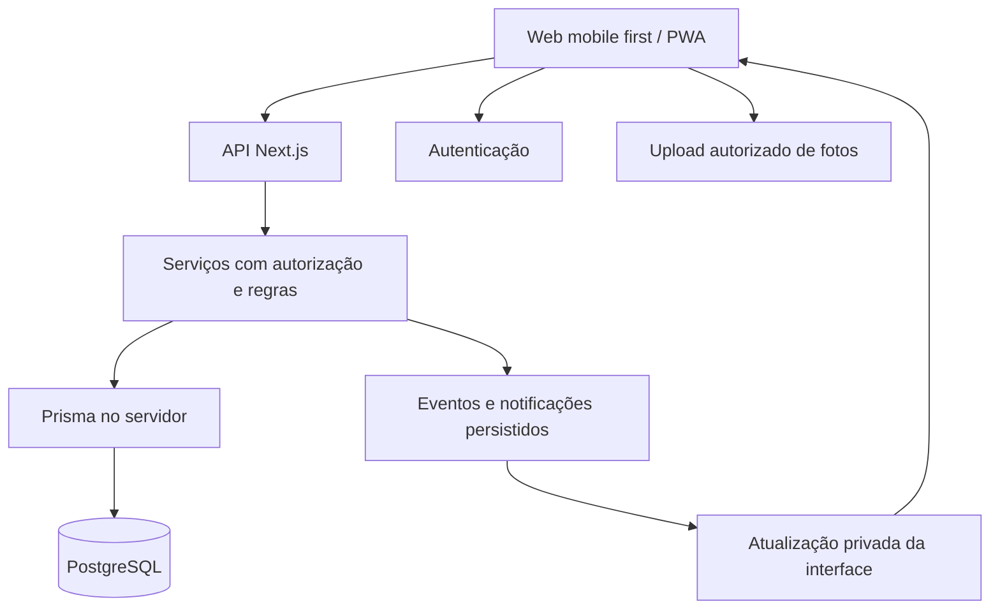

# Meu Mimo — proposta técnica e decisões de dados

Atualizado em 22 de outubro de 2026. Complementa `design.md` e `requisitos.md`.
Registra decisões, propostas futuras e o escopo local implementado em T01–T03.

## 1. Decisões e base da implementação

**Confirmado pelo idealizador:** aplicação mobile first, Prisma para migrações de estrutura do banco, histórico de pontos e resgates no MVP, várias fotos/vídeos publicados pelo lojista em cada resgate e retrospectiva futura no estilo de apresentação do Spotify Wrapped.

Interpretação adotada para “Prisma DB para migração”: **Prisma ORM e suas ferramentas de migração sobre PostgreSQL**.

**D01 confirmada pelo idealizador em M0, em 22/10/2026:** Next.js/React/TypeScript em `web/`, PostgreSQL com Prisma e Supabase para Auth/Storage, com desenvolvimento e testes locais. Essa confirmação não contrata serviços nem autoriza publicação. **D02 confirmada em T02:** e-mail/senha com e-mail verificado, recuperação, retorno seguro ao convite e MFA/TOTP obrigatório para administração provisionada separadamente. Os limites D04 de autenticação e a preparação local foram autorizados; as demais decisões continuam pendentes.

| Camada | Seleção e estado | Responsabilidade |
|---|---|---|
| Aplicação | Next.js, React e TypeScript; confirmados em D01 | Web, API e serviços da aplicação |
| Interface | Tailwind CSS e CSS com tokens semânticos; cinco componentes próprios em T03, sem pacote adicional | Adaptar identidade, composição e assets do protótipo |
| Banco | PostgreSQL 17.11 na stack Supabase local de T02 | Persistência relacional e transações |
| Acesso e migrações | Prisma ORM e migrações versionadas; confirmados | Modelos, consultas e evolução do banco |
| Identidade | Supabase Auth local em T02, com e-mail/senha, verificação, recuperação e MFA administrativo | Autenticação e sessões |
| Fotos e vídeos | Supabase Storage privado; confirmado como serviço, pipeline pendente em D07 | Upload e acesso autorizado |
| Eventos ao vivo | Supabase Realtime com audiência autorizada; proposta para T05 | Avisar a interface sobre mudanças confirmadas |
| Qualidade | Validação de entrada, testes de regras, integração e navegação; requisito | Cobrir autorização, concorrência e uso pelo celular |
| Publicação | Vercel; opção futura, sem implantação autorizada | Hospedar a aplicação Next.js |

Fixar versões estáveis e compatíveis no início da implementação. As interfaces e comandos do Prisma variam entre versões; os comandos operacionais devem ser registrados para a versão escolhida, sem depender de uma instalação implícita de `latest`.

T03 acrescenta `Button`, `Input`, `Dialog`, `StatusBadge` e `PointsSummary` em
`web/src/components/ui/`. O diálogo usa o elemento nativo, estado controlado,
contenção de Tab e retorno do foco ao acionador. Para este escopo, shadcn/ui
não justificou uma dependência adicional. Os contratos estão no
[registro de T03](docs/superpowers/plans/2026-10-22-t03-interface.md).
Fontes DM Sans/DM Serif são locais, com licença, `font-display: swap` e
alternativas. `/visual-check` usa somente dados fictícios em memória, sem
serviços ou persistência; P01/L02 com dados autorizados continuam em T12.

### 1.1. Seleções técnicas de M0

Versões selecionadas em 22/10/2026 por consulta ao registro npm oficial.
Os pacotes de T01/T02 estão declarados e fixados em `web/package-lock.json`.

| Grupo | Versões exatas selecionadas | Etapa |
|---|---|---|
| Runtime preservado | Node.js 24.12.0, npm 11.19.1 | Já existente; mínimo `>=24.12.0 <25` |
| Aplicação | `next` e `eslint-config-next` 16.4.2; `react` e `react-dom` 19.3.1 | T01 |
| Tipagem | `typescript` 6.0.3; `@types/node` 24.19.2; `@types/react` e `@types/react-dom` 19.3.0 | T01 |
| Lint de `web/` | `eslint` e `@eslint/js` 9.39.5; `globals` 16.4.0; `typescript-eslint` 8.72.0 | T01; raiz preserva ESLint 10.13.0 |
| CSS | `tailwindcss` e `@tailwindcss/postcss` 4.3.3; `postcss` 8.5.23 | T01 |
| Navegação automatizada | `@playwright/test` 1.64.1 | T01/T03 |
| Banco | `prisma`, `@prisma/client` e `@prisma/adapter-pg` 7.10.1; `pg` e `@types/pg` 8.23.1 | T02 |
| Identidade | `@supabase/supabase-js` 2.118.0; `@supabase/ssr` 0.12.7 | T02 |
| Ferramentas de servidor/local | `server-only` 0.0.1 em T01; `dotenv` 18.0.8 e CLI `supabase` 2.121.0 em T02 | Instalar apenas na etapa que precisar |

Escolhas do orquestrador: TypeScript 6.0.3 respeita o intervalo declarado por `typescript-eslint` (`>=4.8.4 <6.1.0`), enquanto TypeScript 7.0.2 está fora dele. A CLI Prisma em `latest` apontava para `8.0.0-rc.25`; a linha 7.10.1 mantém CLI, cliente e adaptador alinhados em versões estáveis. Plugins React/import/acessibilidade usados pelo preset Next ainda declaram ESLint 9, razão para isolar o lint de `web/` sem alterar o lint atual nem usar instalação forçada.

O ensaio `npm install --dry-run --ignore-scripts --no-audit --no-fund --package-lock=false` resolveu a árvore de aplicação/banco/testes em diretório descartável ignorado, sem instalar pacotes nem criar lockfile. Engines/peers e resolução não comprovam build, execução, segurança ou testes reais: esses aceites pertencem a T01/T02. Os tipos mais recentes da série Node 24 não autorizam depender de APIs posteriores ao runtime mínimo.

Cada pacote npm terá seu lockfile e seus comandos. A raiz continuará atendendo a demonstração em 4173; a nova aplicação usará 4301. Lint, tipos e build executam em série no mesmo checkout. T02/T03 também ficam em série por padrão, pois portas e `distDir` distintos não isolam fontes, `next-env.d.ts` e arquivos incrementais. O plano concreto está em [M0 e fundação](docs/superpowers/plans/2026-10-22-m0-fundacao.md).

Fontes: [registro npm](https://registry.npmjs.org/), [instalação do Next](https://nextjs.org/docs/app/getting-started/installation), [CLI e geração de tipos](https://nextjs.org/docs/app/api-reference/cli/next), [Prisma Migrate v7](https://www.prisma.io/docs/orm/v7/prisma-migrate/workflows/development-and-production), [Supabase com Prisma](https://supabase.com/docs/guides/database/prisma) e [Supabase local](https://supabase.com/docs/guides/local-development/cli/getting-started). Context7 foi consultado para Next, Prisma e Supabase; a documentação versionada do Prisma v7 prevalece sobre páginas genéricas que já descrevem outra linha.

## 2. Organização da aplicação

- Separar módulos de contas, lojas, participantes, atividades, registros, pontos, mimos, tickets, bilhetes e notificações.
- Executar Prisma somente em ambiente de servidor. Navegador não recebe credenciais de banco.
- Validar sessão, papel, loja e participação antes de consultar ou alterar recursos privados.
- Processar aprovação, resgate e estorno em serviços transacionais. SQL específico é permitido quando necessário para restrições, bloqueios ou funções do PostgreSQL.
- Realtime comunica uma mudança confirmada; a consulta autorizada continua sendo a fonte dos dados. Falha de conexão ou evento perdido é recuperada por nova consulta.
- Upload pode ir diretamente ao Storage com autorização apropriada, evitando transformar a API de aplicação em passagem obrigatória de arquivos grandes.

### 2.1. Prisma e autorização

Uma conexão Prisma ao PostgreSQL não herda automaticamente a identidade do usuário do Supabase Auth. Dependendo do papel da conexão, ela também pode não estar sujeita a RLS. A implementação precisa verificar o modelo de conexão e as permissões efetivas.

Por isso, a autorização da API e os filtros por loja/participação são obrigatórios em consultas Prisma. RLS, grants e políticas do Storage/Realtime complementam a proteção nos caminhos em que se aplicam; não substituem essa validação.

Definir os caminhos públicos de dados explicitamente. Se a aplicação acessa tabelas de negócio apenas pelo backend, restringir a Data API correspondente e impedir escritas diretas do navegador em pontos, tickets e decisões de análise. Canais de Realtime têm autorização própria e não podem expor uma relação a todos os participantes da loja.

## 3. Migrações de estrutura com Prisma

O uso de Prisma para migração foi escolhido; o procedimento abaixo é a proposta operacional:

1. Alterar os modelos do banco no projeto e gerar uma migração em desenvolvimento.
2. Revisar o SQL e seus efeitos em dados existentes, nomes, índices e permissões.
3. Incluir SQL complementar necessário, como políticas RLS e restrições que a modelagem não represente, na mesma cadeia versionada de migrações da aplicação.
4. Testar em banco de desenvolvimento/teste antes de aplicar ao ambiente real.
5. Na publicação, aplicar somente migrações previamente revisadas pelo comando de produção da versão escolhida.
6. Registrar o resultado, verificar compatibilidade entre código e esquema e manter estratégia de recuperação.

Prisma será responsável pela evolução do esquema da aplicação. Esquemas internos gerenciados pelo Supabase, como Auth e Storage, permanecem sob responsabilidade do serviço; não devem ser recriados pelo ORM.

Uma alteração de dados em produção exige preservar o histórico e planejar transformações. Corrigir um lançamento de pontos usa um movimento compensatório do domínio; não é uma migração de esquema.

Para a implantação serverless proposta, definir pooling, orçamento de conexões e conexão apropriada para execução de migrações conforme o provedor e a versão adotados. Credenciais ficam somente nos ambientes autorizados.

Referências técnicas: [Prisma com Supabase](https://supabase.com/docs/guides/database/prisma), [customização de migrações](https://www.prisma.io/docs/orm/v7/prisma-migrate/workflows/customizing-migrations), [desenvolvimento e produção](https://www.prisma.io/docs/orm/v7/prisma-migrate/workflows/development-and-production). As duas últimas descrevem Prisma ORM v7 e precisam ser revalidadas se outra versão for escolhida.

### 3.1. Fundação local de T02

O schema privado `app` contém Profile, Store, Membership e AdminGrant; não
modela os estados de negócio ainda dependentes de D03–D09. AuthSession
mantém revogação/contexto restrito, AuthRateBucket persiste a janela atômica
e SecurityAudit registra evento/ator/instante sem senha, token ou e-mail.
As três migrações em `web/prisma/migrations/` incluem o SQL de permissões.
Auth/Storage mantêm seus schemas gerenciados pelo Supabase.

Runtime usa `meumimo_runtime`, sem superuser/bypass de RLS ou escrita em
AdminGrant, Store e Membership. `anon`/`authenticated` não acessam `app`, que
também fica fora da Data API. RLS restringe o papel de conexão; identidade e
escopo de loja continuam obrigatórios na API Prisma. O pool local usa no
máximo 5 conexões, timeout de conexão 5 s e ociosidade 10 s.

`getUser` e claims verificados, e-mail confirmado, AuthSession ativa e perfil
não suspenso formam a identidade. Cada consulta privada revalida sessão e
permissão. Callback exige contexto HMAC ligado ao verifier PKCE e método AMR
compatível no JWT assinado pelo Auth (`email/signup` ou `recovery`). Sessões
de recuperação só alteram senha/saem; administração exige grant separado e AAL2.
Cookies de renovação são propagados com HttpOnly/SameSite=Lax; respostas
privadas usam no-store. As mutações validam Origin, JSON e corpo limitado.

Stack comprovada: Docker Desktop 4.96.2, engine Linux 29.9.2 e PostgreSQL
17.11 (imagem `public.ecr.aws/supabase/postgres:17.11.0.004`), com Supabase
CLI 2.121.0 e Auth 2.197.0. Desenvolvimento, shadow e
integração usam bancos separados; 54321/54322/54324 estão em loopback.
Configuração, comandos, provisionamento administrativo e limites operacionais
estão em [identidade local](docs/identity-local.md). Nenhuma migração ou
implantação em ambiente real foi executada.

## 4. Modelo conceitual de dados

A tabela descreve o modelo completo proposto. T02 implementa somente o
subconjunto mínimo da seção 3.1; os demais modelos permanecem futuros.

| Entidade | Dados e responsabilidade principais |
|---|---|
| User / Profile | Identidade da conta, nome e preferências |
| Store | Responsável, identidade, fuso e estado |
| Membership | Participante, loja, estado e início/fim da relação |
| Invitation | Destino da loja, token protegido, validade, aceite e revogação |
| Activity | Definição editável, pontos, frequência e modo de aprovação |
| ActivitySubmission | Pessoa, loja, atividade, data da atividade/envio, evidências e regra/pontuação da ocasião |
| SubmissionEvent | Autor, decisão, motivo e data de cada mudança de análise |
| MediaAttachment | Autor, tipo foto/vídeo, propósito evidência/memória, loja, participação, registro ou resgate de origem, objeto privado, estado, legenda, ordem, duração/dimensões quando aplicáveis e política de retenção |
| PointsWallet | Participação, saldo de consulta e versão para controle de concorrência, se houver saldo materializado |
| PointsEntry | Movimento confirmado, valor inteiro com sinal, tipo, origem, autor, data e referência de compensação |
| Reward | Definição editável, custo, categoria, disponibilidade e instruções |
| Redemption | Participação, ticket, custo e conteúdo da ocasião do resgate, estado e datas de marcos |
| RedemptionEvent | Linha do tempo de combinado, realização, pedido/resolução de cancelamento e motivos |
| Comment / Reaction | Conversa/reação vinculada a registro ou ticket, com audiência da relação |
| PersonalNote / NoteRead | Bilhete, destinatário, versão, data de envio e leitura daquela versão |
| Notification / OutboxEvent | Novidade persistida e evento a entregar com controle de repetição |
| RetrospectiveSnapshot | Futuro: período, participação, métricas agregadas, data de corte e versão do cálculo |

Índices e restrições devem cobrir participação por loja/pessoa, consultas históricas por período, decisões idempotentes, origem dos movimentos e emissão de tickets. Definir identificadores estáveis para filtrar e agregar mesmo quando nomes forem alterados.

## 5. Histórico de pontos e prêmios

### 5.1. Extrato de pontos

- Registrar créditos de atividade, bônus explícitos futuros, débitos de resgate, estornos de crédito e devoluções de cancelamento como tipos distintos.
- Um registro em análise não é um crédito confirmado e não faz parte do saldo disponível.
- Movimentos confirmados são acrescentados ao extrato. O fluxo normal da aplicação corrige por compensação vinculada ao movimento original, preservando a explicação do ocorrido.
- Se houver saldo materializado para leitura rápida, atualizá-lo na mesma transação do movimento e permitir reconciliá-lo com a soma do extrato.
- Guardar autor, origem, valor, data, identificação de repetição e ordenação estável por carteira. O detalhe histórico abre o registro/ticket autorizado.
- Não somar saldos de lojas diferentes. Cada loja define sua própria economia.

### 5.2. Histórico de resgates

- Preservar código, nome, descrição/instruções relevantes e custo da ocasião do resgate.
- Registrar separadamente data do resgate, combinado, realização e cancelamento. Manter eventos de alteração e motivos.
- Uma edição ou arquivamento do prêmio no catálogo não muda o ticket anterior.
- Exibir resgates ativos, realizados e cancelados, com filtros e paginação; contador de navegação considera somente os ainda a realizar.
- Histórico preservado respeita a política de retenção, exclusão e anonimização a definir. Fotos não precisam ter a mesma duração de retenção dos movimentos estruturados.
- Cada resgate pode conter várias fotos/vídeos de momentos publicados pelo lojista. O álbum é uma relação de um ticket para muitos anexos, com audiência daquela participação.

### 5.3. Consistência

Na aprovação: validar autor/papel e estado, registrar decisão, creditar quando aplicável e persistir o evento de notificação como uma operação consistente.

No resgate: validar participação, estado da loja, custo, saldo e estoque; criar o ticket e seu movimento na mesma transação. No cancelamento: resolver o pedido e devolver pontos uma única vez.

Concorrência exige combinação apropriada de isolamento, bloqueio/atualização condicional, unicidade, identificação de repetição e novas tentativas controladas. Uma transação isoladamente não define toda a política de concorrência.

Referência: [transações no Prisma ORM v7](https://www.prisma.io/docs/orm/v7/prisma-client/queries/transactions). Ajustar APIs e opções à versão estável escolhida.

### 5.4. Álbum privado por resgate

- Guardar arquivos no Storage; Prisma/PostgreSQL guardam metadados, vínculos, autoria, ordenação, legenda e estados. Não colocar os vídeos em colunas binárias do banco nem persistir URLs temporárias como identificador permanente do arquivo.
- Distinguir propósito e vínculo de cada mídia. Evidência pertence a um registro; memória pertence a um resgate. Impedir anexos soltos ou vinculados a registros/resgates de outra relação.
- Usar upload autorizado direto e retomável quando apropriado. Persistir o resultado de cada arquivo e publicar somente itens que passaram pela validação e foram confirmados pelo lojista.
- Estado de envio/processamento pertence à mídia e não altera o estado do ticket. Publicar um lote gera uma novidade agrupada, com identificação de repetição para não duplicar o aviso.
- Armazenamento privado exige autorização também para reprodução, miniaturas e acesso temporário aos vídeos. Outros participantes da loja não acessam o álbum.
- Definir formatos, duração, tamanho, miniaturas e necessidade de conversão antes do piloto. Supabase Storage oferece armazenamento/upload, mas a eventual conversão de vídeo exige um fluxo de processamento escolhido e testado separadamente.
- Falha de processamento permite tentar novamente ou remover o item; o ticket e o fluxo de pontos continuam consistentes.
- Seleção de momentos para retrospectiva referencia os anexos autorizados e respeita remoção/retenção. Não copiar automaticamente mídia privada para um local público.

Referências: [uploads retomáveis com TUS no Supabase](https://supabase.com/docs/guides/storage/uploads/resumable-uploads) e [acesso privado a arquivos](https://supabase.com/docs/guides/storage/buckets/fundamentals).

## 6. Preparação para retrospectiva

### 6.1. Capturar desde o MVP

- Identificadores de conta, loja, participação, atividade, registro, movimento e ticket.
- Categoria e conteúdo relevante da ocasião, com política de retenção definida.
- Datas distintas de realização da atividade, envio, aprovação, crédito, resgate, realização do mimo e estorno; instantes armazenados em UTC e períodos apresentados no fuso da loja.
- Eventos de aprovação/anulação e cancelamento, com vínculo ao crédito ou ticket corrigido.
- Origem dos pontos: atividade, bônus ou devolução. Separar crédito original de correções e recomposições.
- Datas e versão dos bilhetes, para uma futura seleção pessoal, sem exigir retenção ilimitada de textos e fotos.
- Fotos/vídeos dos álbuns com vínculo ao ticket e data/publicação, permitindo selecionar momentos reais do período com autorização.

É suficiente guardar os dados de domínio necessários e indexá-los. Não é necessário construir agora um sistema genérico de eventos, uma ferramenta de analytics própria ou o gerador de stories.

### 6.2. Métricas propostas

| Métrica | Definição para a evolução |
|---|---|
| Conquistas válidas | Registros que receberam aprovação válida, considerando anulações até a data de corte |
| Dias com conquistas | Dias distintos das atividades válidas no fuso e período definidos |
| Pontos conquistados por atividade | Créditos de atividade do período, descontadas compensações vinculadas consideradas no corte; excluir devoluções de resgate e bônus |
| Atividade mais frequente | Contagem de registros válidos por identificador da atividade, com desempate explícito |
| Mimos resgatados | Tickets emitidos no período, distinguindo os que foram cancelados até o corte |
| Mimos realizados | Eventos de realização no período; não presumir realização a partir de resgate |
| Mimo mais resgatado | Resgates válidos por identificador do mimo, sem reescrever nomes históricos |
| Momentos pessoais | Fotos, vídeos dos álbuns, bilhetes e experiências selecionados para aparecer pelo participante |

Uma atividade pode ter acontecido em dezembro e ser aprovada em janeiro. A métrica de atividade pode usar a data de realização; a métrica de pontos usa a data do crédito. Essa diferença precisa estar definida e explicável.

Cada retrospectiva registra período, fuso, data de corte, versão do cálculo e geração. Uma correção posterior pode exigir uma nova versão; não alterar silenciosamente o significado dos números de uma retrospectiva já apresentada.

Começar por participação/loja. Uma visão pessoal de várias lojas pode agregar contagens compatíveis, mantendo pontos separados. Respeitar as mesmas permissões do histórico, a política de retenção e a escolha explícita de imagens/bilhetes compartilhados.

### 6.3. Implementação futura

Proposta: agregar dados no servidor, gerar um snapshot autorizado e renderizar uma sequência de cards na interface mobile. A narrativa pode usar templates determinísticos e a identidade visual existente. Fotos pessoais, publicação e compartilhamento dependem de escolha e revisão da pessoa.

Periodicidade, elegibilidade com poucos dados e regras de regeneração serão definidas antes de implementar a retrospectiva.

## 7. Verificação antes do piloto

- Validar autorizações reais usando as credenciais e caminhos de acesso que a aplicação empregará, incluindo Prisma, Storage e Realtime.
- Testar aprovação/resgate/estorno simultâneos e repetidos, conferindo saldo, extrato, estoque e tickets.
- Testar que renomear/arquivar atividade ou mimo preserva os dados históricos da ocasião.
- Verificar filtros e paginação do histórico no celular e separação entre lojas/pessoas.
- Testar migrações em ambiente separado, recuperação de banco/arquivos e evolução do esquema com dados já existentes.
- Confirmar que eventos coletados permitem as métricas futuras sem transformar devoluções em conquistas ou tickets cancelados em mimos realizados.
- Verificar upload de várias mídias, retomada após falha, publicação parcial explícita, reprodução em Android/iPhone e privacidade por resgate, incluindo miniaturas.
