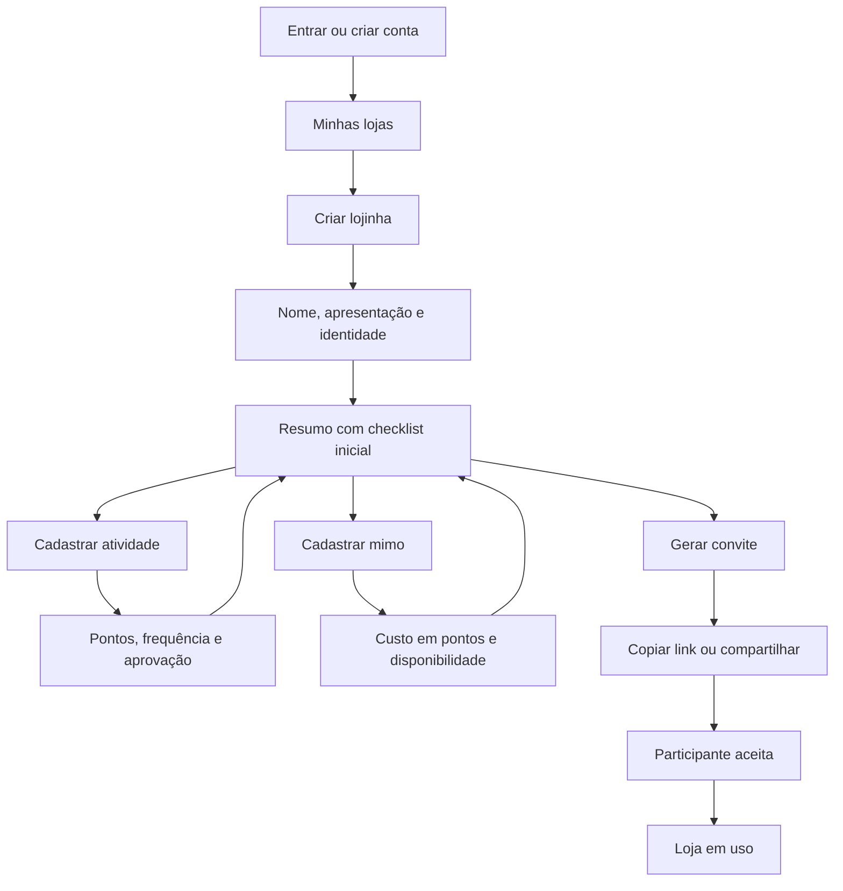
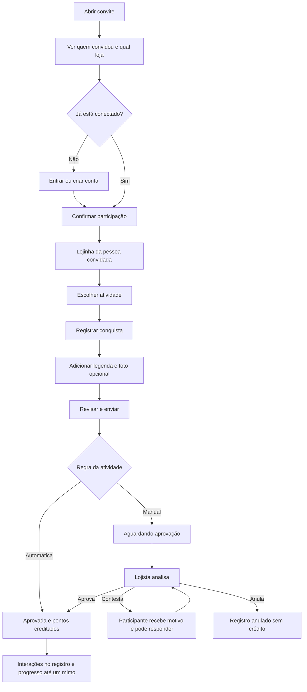
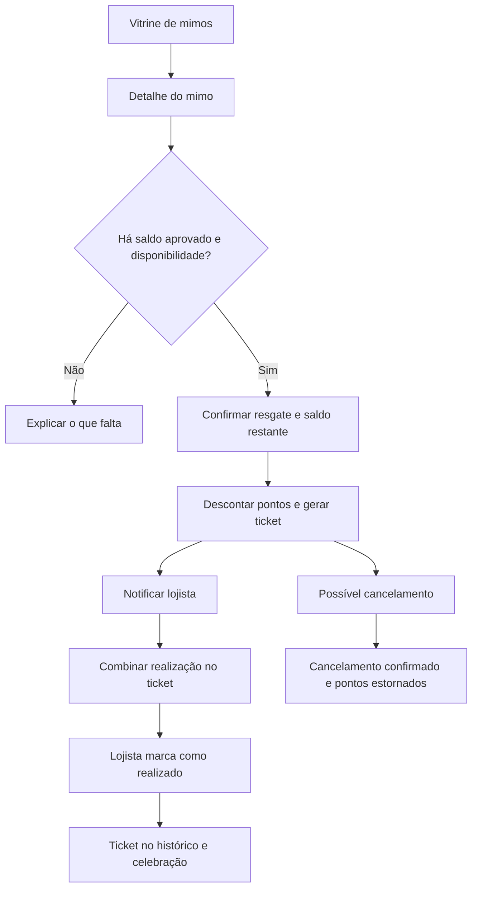
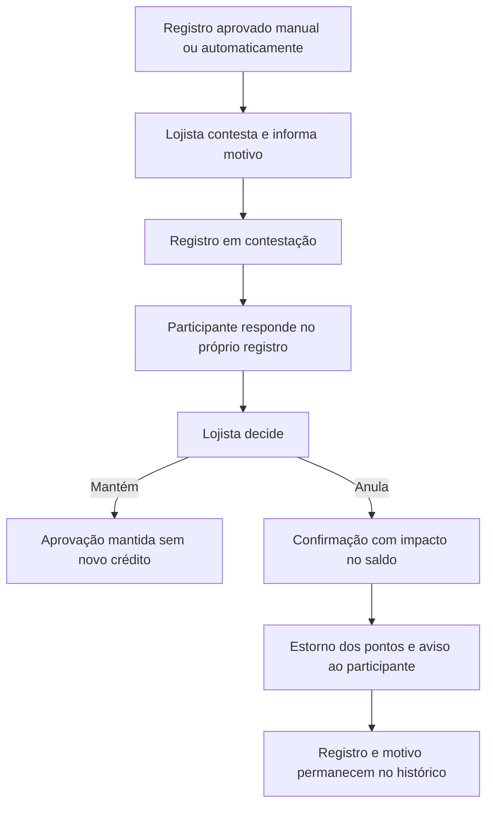

# Meu Mimo — identidade visual, telas e fluxos do app

Especificação para o designer. Atualizada em 21 de outubro de 2026.

Este documento reúne a direção visual existente, a experiência aprovada como referência no protótipo e a proposta de produto. As decisões confirmadas pelo idealizador estão na seção 5; os comportamentos operacionais propostos para completar os fluxos estão identificados ao longo do documento. A seção 21 registra a consolidação do protótipo com esta especificação; `requisitos.md` complementa as regras de implementação.

## 1. Conceito e sensação

**Uma lojinha de carinho com aparência de presente personalizado.**

Conceito da marca: **“Sua lojinha de carinho para alguém especial.”**

O Meu Mimo é uma plataforma em que uma pessoa cria uma lojinha privada, cadastra atividades e recompensas e convida alguém especial para participar. A pessoa convidada registra suas conquistas, acumula pontos e escolhe quais mimos deseja resgatar.

O público inicial são casais adultos que gostam de presentear, criar brincadeiras próprias e apoiar os objetivos um do outro. A interface será pensada primeiro para celular.

A direção visual, inspirada na [pasta de referências do Pinterest](https://br.pinterest.com/rafaelgiustina2/meumimocom/), combina **papelaria afetiva, scrapbook de moda e humor de bichinhos**. Os rosas trazem ternura; o branco dá leveza; as colagens acrescentam personalidade e cumplicidade.

A identidade será **delicada, feminina, acolhedora e divertida**, com linguagem pensada para casais adultos. A sensação central é: *“alguém escolheu cada detalhe pensando em mim”*.

## 2. Paleta proposta

Cores sugeridas a partir das referências e do conceito do produto:

| Cor | HEX | Função no app |
|---|---|---|
| **Branco rosado** | `#FFF8FB` | Fundo principal, suave e luminoso |
| **Branco papel** | `#FFFFFF` | Cards, campos e recortes de stickers |
| **Rosa nuvem** | `#FCE8F0` | Blocos delicados, seleções e fundos de ilustrações |
| **Rosa mimo** | `#F2A7C4` | Cor assinatura da marca, embalagens e detalhes |
| **Rosa chiclete** | `#E76E9A` | Corações, selos e pequenas celebrações |
| **Rosa framboesa** | `#B23A68` | Botões principais, links e controles ativos |
| **Framboesa escuro** | `#922C54` | Estado pressionado e interação dos botões principais |
| **Ameixa suave** | `#4A2E3B` | Títulos, textos e saldo de pontos |
| **Malva** | `#785A68` | Descrições, legendas e informações secundárias |
| **Rosa pétala** | `#EED4E0` | Divisórias e contornos decorativos |
| **Creme presente** | `#FFF2D8` | Tickets, vales e pequenos destaques de recompensas |

**Distribuição inicial:** aproximadamente 70% branco e branco rosado, 20% rosas claros e 10% cores de destaque. Essa proporção orienta as superfícies; textos e fotografias ficam fora da conta.

O rosa pastel será a identidade emocional. O framboesa concentrará as ações importantes, como **“Resgatar mimo”**, **“Registrar conquista”** e **“Enviar convite”**.

## 3. Linguagem visual e aplicação

- **Animais com acessórios:** fotografias recortadas de gatos, cachorros e outros bichinhos com óculos, laços, unhas ou sapatos. Composições com humor carinhoso e referências às brincadeiras do casal.
- **Colagens:** bordas brancas de adesivo, pequenas sobreposições e inclinações discretas. Usar nas boas-vindas, nos presentes e nas comemorações.
- **Ilustrações brancas:** desenhos simples de laços, estrelas, corações, patinhas e presentes sobre fundos rosas. Traços arredondados e delicados.
- **Recompensas:** cards com aparência de cartões-presente e tickets, usando branco, rosa nuvem e creme.
- **Interface:** formas arredondadas, bastante espaço entre elementos e tipografia confortável. A expressão mais divertida ficará nas imagens e nos títulos curtos.
- **Duas experiências principais, uma identidade:** quem cria encontra um ambiente organizado para preparar os mimos; quem recebe encontra uma vitrine acolhedora, com saldo e recompensas em destaque. A administração da plataforma terá uma área própria, com a mesma base visual e menor presença de decoração.
- **Fotos de atividades:** são conteúdo pessoal dos participantes. Exibi-las com legibilidade, sem colagens que escondam a imagem, e indicar quem pode vê-las. Stickers decorativos da marca devem ficar fora da foto original.

Como ponto de partida, usar uma composição de stickers por tela principal e pequenos elementos decorativos nos cards, preservando espaço para as atividades e os valores.

### 3.1. Referência visual consolidada do protótipo

- Adotar a composição de papelaria afetiva do [protótipo de referência](https://meu-mimo-carinho.rafael-giustina2.chatgpt.site/): marca em minúsculas com laço e ponto framboesa, gatinho fotográfico com acessórios, cards suaves e bilhetes com aparência de papel.
- Usar **DM Serif Display** em saudações, títulos afetivos, títulos de mimos e bilhetes. Reservar o itálico a frases curtas e destaques pessoais.
- Usar **DM Sans** em textos de leitura, navegação, formulários, botões, estados, preços e números do saldo. Prever fontes alternativas e carregamento sem bloquear o uso.
- Como alvos de leitura, partir de 16 px para texto corrido, 14 px para descrições curtas e 12 px para legendas auxiliares; verificar no aparelho real. A implementação final deve ampliar os textos pequenos do protótipo quando necessário.
- Aproveitar o gatinho existente em `prototype/dist/assets/mimo-kitten.png` e a linguagem dos SVGs de recompensas. A origem dos assets está em `prototype/ASSETS.md`.
- Manter o cartão **“Seu potinho de pontos”** como destaque funcional e afetivo. Mostrar saldo disponível em primeiro plano e pendência de análise separada, sem sobrepor os números com stickers.
- A vitrine usa duas colunas quando houver espaço para leitura confortável. Em largura reduzida ou com texto ampliado, pode passar a uma coluna.
- Detalhes de mimos, extrato e bilhetes usam painéis com fechamento claro e retorno ao ponto de origem. No celular, podem ocupar a base ou toda a altura útil conforme o conteúdo; no desktop, um modal de largura confortável.
- Manter tickets com divisórias tracejadas e recortes semicirculares, recadinhos nos mimos e celebrações curtas, respeitando movimento reduzido.
- A moldura de telefone e a composição publicitária no desktop continuam úteis para demonstração. A aplicação final adapta o conteúdo ao espaço disponível para permitir gestão e leitura confortáveis.

## 4. Regras de uso e validação

- Nomear as cores por função na implementação: `background`, `surface`, `brand`, `action`, `text`, `text-muted` e `border`.
- Usar texto branco nos botões framboesa e texto ameixa sobre os fundos claros. O contraste calculado entre branco e framboesa é de **5,68:1**; entre ameixa e branco rosado, **11,50:1**.
- Reservar os rosas claros para superfícies e decoração. Controles e campos devem ter contornos suficientemente visíveis.
- Para estados funcionais, usar verde suave com texto `#35654F` em confirmações e fundo rosa claro com texto `#9B3548` em erros, sempre acompanhados de mensagem ou ícone.
- Validar a paleta no celular em três composições: **vitrine de recompensas**, **atividades com saldo de pontos** e **formulário de criação de mimo**.
- Confirmar que preços em pontos, ações e estados continuam claros mesmo com stickers e fotografias presentes.

**Premissas:** tema claro como padrão inicial, rosa e branco como cores fixas da marca e creme como apoio pontual. As seções seguintes detalham funcionalidades, navegação e estados de interface.

### 4.1. Complementos funcionais da paleta

| Token | HEX | Aplicação |
|---|---|---|
| `border-control` | `#A8748C` | Contornos de campos e controles que precisam ser percebidos |
| `focus` | `#7A2850` | Foco de teclado e realce de navegação |
| `success-bg` / `success-text` | `#E8F4EC` / `#35654F` | Atividade aprovada, envio concluído e entrega realizada |
| `pending-bg` / `pending-text` | `#FFF2D8` / `#7A5418` | Registro aguardando análise e mimo aguardando realização |
| `error-bg` / `error-text` | `#FFF0F3` / `#9B3548` | Erros e atividade anulada |
| `info-bg` / `info-text` | `#F0ECFA` / `#52457A` | Contestação, orientações e avisos informativos |

Contrastes calculados para as combinações acima: sucesso **5,95:1**, pendência **6,09:1**, erro **6,34:1**, informação **7,26:1**. Malva sobre branco rosado: **5,80:1**; sobre rosa nuvem: **5,18:1**. O contorno funcional sobre branco tem **3,79:1**.

- Buscar contraste mínimo de **4,5:1** para texto comum e **3:1** para texto grande e elementos funcionais essenciais.
- `Rosa pétala` continua como contorno decorativo; não deve ser a única identificação de um campo ou controle.
- Ilustrações brancas sobre rosa são decorativas. Se representarem ação ou informação, precisam de rótulo e contraste funcional.
- Usar texto, ícone e cor juntos para diferenciar estados. Um coração rosa não pode ser a única indicação de aprovação.
- Prever áreas de toque de pelo menos **44 × 44 px**, foco visível, ampliação de texto e preferência por movimento reduzido.

## 5. Escopo e decisões de produto

### 5.1. Decisões confirmadas

1. O produto tem administrador da plataforma, lojista e participante.
2. Uma pessoa tem uma conta e pode criar N lojas e participar de N outras lojas. Limites e planos poderão ser adicionados depois.
3. O lojista cadastra atividades, pontuações e mimos e convida outras pessoas para sua loja.
4. Uma loja pode receber várias pessoas. Cada participante tem saldo e histórico próprios e privados.
5. O participante registra a atividade por iniciativa própria e pode enviar uma foto da galeria ou da câmera.
6. Aprovação do lojista é o padrão para liberar pontos. Cada atividade pode ser configurada para aprovação automática.
7. O lojista pode contestar e anular uma atividade registrada.
8. Participante e lojista podem interagir com emojis e receber notificações.
9. A aplicação será **mobile first**: os fluxos de participante, lojista e as tarefas essenciais de administração precisam funcionar integralmente pelo celular. O produto começa na web, com caminho para PWA e app futuro.
10. A identidade visual deve preservar a direção de rosa pastel, papelaria, colagens, stickers e animais com acessórios descrita acima.
11. Históricos de pontos obtidos, gastos e estornados e de mimos resgatados fazem parte do MVP.
12. Uma retrospectiva futura deve apresentar conquistas e momentos em cards, inspirada na experiência de retrospectiva do Spotify, com identidade própria do Meu Mimo.
13. O lojista pode adicionar várias fotos e vídeos a cada mimo resgatado, formando um álbum privado daquela experiência.

As referências de GymRats e Life360 orientam, neste brief, a dinâmica descrita pelo idealizador: registrar uma conquista, compartilhar uma foto, reagir e receber uma notificação. A interface terá linguagem e organização próprias do Meu Mimo.

### 5.2. Nomes e papéis

| Nome na especificação | Responsabilidade | Onde existe |
|---|---|---|
| **Administrador** | Opera a plataforma, suas contas e lojas | Permissão administrativa da conta |
| **Lojista** | Cria e gerencia sua loja, analisa registros e oferece os mimos | Papel naquela loja |
| **Participante** | Registra atividades, acumula pontos e resgata mimos | Papel naquela loja |

**Nome recomendado para quem pontua: Participante.** É claro para cadastro, permissões e navegação. A comunicação pode usar “seus mimos”, “suas conquistas” e o nome da pessoa; “mimado(a)” pode aparecer como expressão carinhosa, sem virar um papel obrigatório.

Lojista e participante não são tipos fixos de conta. Exemplo: Ana gerencia “Mimos da Ana” e participa de “Cantinho do Rafa” usando o mesmo login. O cadastro não deve pedir que a pessoa escolha um papel permanente.

### 5.3. Decisões operacionais propostas para o MVP

- Cada loja tem um lojista responsável; colaboradores e transferência de propriedade ficam para evolução.
- O lojista não pontua na própria loja. Pode pontuar nas lojas de outras pessoas.
- Pontos pertencem à relação participante–loja. Não são transferidos ou somados entre lojas e não têm conversão em dinheiro.
- Registros, fotos, comentários, saldo, tickets e movimentações são visíveis somente ao participante envolvido e ao lojista. Outros participantes da mesma loja não os veem.
- As definições de atividades e o catálogo de mimos são compartilhados com os participantes da loja. Uma recompensa com estoque compartilhado mostra sua disponibilidade, sem revelar quem a resgatou.
- Aprovação manual é a seleção inicial no cadastro de atividade; o lojista pode escolher aprovação automática, com explicação clara.
- Foto e legenda são opcionais no primeiro MVP. Prever uma foto por registro, com câmera ou galeria.
- O resgate desconta pontos aprovados imediatamente e gera um ticket. A realização do mimo acontece depois, combinada entre as pessoas.
- Não há perda de pontos por faltar ou quebrar uma sequência. Anulação de crédito indevido é um estorno identificado no extrato.
- Contas e lojas não recebem limites comerciais nesta versão. Listas e seletores devem comportar muitas lojas.

## 6. Estrutura da conta e troca de contexto

### 6.1. Central “Minhas lojas”

Após entrar sem um convite específico, a pessoa acessa a central com duas abas:

- **Lojas que participo:** cards com identidade da loja, nome de quem oferece os mimos, saldo disponível naquela loja e botão “Entrar”.
- **Lojas que criei:** cards com identidade da loja, quantidade de participantes, registros pendentes e botão “Gerenciar”.

O botão **“Criar lojinha”** permanece disponível nas duas abas. Para contas com muitas lojas, incluir busca por nome e listas com carregamento progressivo. Não exibir um saldo global somando lojas.

No primeiro acesso, se não houver lojas, mostrar duas orientações: criar sua lojinha ou abrir o link de convite recebido. Aceitar um convite não obriga a pessoa a criar uma loja.

### 6.2. Cabeçalho dentro de uma loja

- Avatar e nome da loja atual.
- Indicação de contexto: **“Participando”** ou **“Gerenciando”**.
- Acesso ao seletor de lojas.
- Sino de notificações, com contador de itens não lidos.
- Na experiência de participante, coração para o bilhete pessoal daquela loja, com ponto de não lido. O coração não substitui o sino: bilhete e notificações têm funções distintas.
- Acesso à conta pelo menu ou avatar pessoal, visualmente distinto do avatar da loja.

Em larguras pequenas, usar uma linha de marca/ações e uma linha compacta de contexto e seletor de loja, ou uma marca compacta. Preservar áreas de toque em vez de apertar todos os controles na mesma linha.

O seletor abre como painel ou bottom sheet no celular e popover no desktop. Separar as lojas por papel e destacar a atual. Ao trocar, atualizar navegação, saldo, pessoas e conteúdo juntos.

Notificações e links diretos podem abrir outra loja: primeiro verificar o acesso e então mostrar claramente o contexto de destino. Se a pessoa estiver sem acesso, explicar a situação sem exibir o conteúdo privado.

### 6.3. Administrador

Uma conta com permissão administrativa recebe acesso adicional a **“Administração da plataforma”**. Essa área usa navegação própria. O administrador pode também possuir ou participar de lojas, sem misturar essas experiências.

## 7. Navegação principal

| Contexto | Navegação no celular | Acessos complementares |
|---|---|---|
| Participante | **Lojinha · Atividades · Meus mimos** | Extrato pelo potinho e por Meus mimos; bilhete, mural privado, notificações, informações da loja, conta e seletor |
| Lojista | **Resumo · Atividades · Mimos · Pessoas** | Notificações, configurações da loja, conta e seletor |
| Administrador | Menu de **Visão geral · Contas · Lojas** | Detalhe administrativo e histórico de ações |

- Em **Atividades**, o lojista alterna entre “Cadastros” e “Registros”; registros têm filtros por status e participante.
- Em **Mimos**, o lojista alterna entre “Catálogo” e “Resgates”; resgates têm filtros por status e participante.
- Em **Meus mimos**, o participante alterna entre “Tickets” e “Extrato”. O potinho também abre o extrato em um painel, com os mesmos dados.
- A **Lojinha** reúne saudação, potinho, atalhos de atividades, vitrine e bilhete. A vitrine completa e o detalhe de um mimo são acessados por essa aba; não precisam de uma aba inferior própria.
- O **mural privado** é aberto a partir da Lojinha, dos registros ou do perfil do participante. Não ocupa uma quarta aba inferior.
- O contador de **Meus mimos** representa tickets ainda a realizar, incluindo cancelamentos em análise; exclui tickets realizados e cancelados. O total histórico fica dentro da tela.
- No desktop, substituir a barra inferior por navegação lateral. A administração também começa pelo celular, com listas de cards, filtros e ações acessíveis por toque; tabelas no desktop complementam essa experiência.

## 8. Fluxos principais

### 8.1. Criar e preparar uma loja

O checklist recomenda cadastrar ao menos uma atividade e um mimo antes de convidar. Proposta: permitir enviar o convite mesmo assim e tratar a loja ainda vazia com uma mensagem acolhedora, sem bloquear o lojista.

### 8.2. Receber convite e registrar uma conquista

### 8.3. Resgatar e realizar um mimo

### 8.4. Contestar uma atividade já aprovada

## 9. Telas comuns à conta

Os IDs abaixo servem para referência no Figma e nos fluxos. Abas, modais e estados não precisam virar páginas independentes.

| ID | Tela | Conteúdo e comportamento | Ação principal |
|---|---|---|---|
| C01 | Entrar / criar conta | Autenticação, recuperação de acesso e aceite dos termos aplicáveis. Preservar o destino de um convite durante todo o processo. Não escolher papel fixo. | Entrar / criar conta |
| C02 | Convite | Nome e avatar da loja, identidade de quem convida, explicação curta de como funciona e privacidade. Se já conectado, mostrar com qual conta o convite será aceito. Não abrir fotos, histórico ou catálogo privado antes do aceite. | Aceitar convite |
| C03 | Minhas lojas | Abas por papel, busca, cards de lojas, estado vazio e acesso à criação. Mostrar saldo somente no card da respectiva participação. | Entrar / gerenciar / criar lojinha |
| C04 | Notificações | Lista global com loja, pessoa, evento, horário e estado de leitura. Filtros por loja e categoria. Um toque abre o item na loja correta. | Abrir novidade |
| C05 | Minha conta | Nome, avatar, dados de acesso, preferências de notificação, privacidade e sair da conta. Preferências por loja acessíveis daqui. Administração só aparece para quem tem permissão. | Salvar alterações |
| C06 | Bilhete pessoal — painel | Mensagem privada do lojista para aquele participante, assinatura e estado lido/não lido da versão atual. Aberto pelo coração ou pelo cartão na Lojinha. | Guardar esse carinho |

O seletor de lojas é um componente compartilhado, acessível a partir de C03 e do cabeçalho. A autenticação deve prever o retorno ao convite e mensagens de erro sem perder o contexto.

## 10. Telas do lojista

| ID | Tela | Conteúdo e comportamento | Ação principal |
|---|---|---|---|
| L01 | Criar lojinha | Nome, apresentação curta, avatar/capa opcionais e prévia. Identidade padrão pronta para usar; personalização não deve impedir a criação. | Criar lojinha |
| L02 | Resumo | Checklist inicial ou resumo em uso: registros pendentes, mimos a realizar, participantes e acontecimentos recentes. Atalhos para cadastrar e convidar. O mural mostra a pessoa de cada registro somente ao lojista. | Analisar pendências |
| L03 | Atividades | Abas “Cadastros” e “Registros”. Cadastros mostram nome, pontos, frequência, regra de aprovação e status. Registros têm filtros por pessoa, atividade, data e status. | Nova atividade / abrir registro |
| L04 | Criar / editar atividade | Nome, descrição, categoria opcional, pontos por ocorrência, frequência/limite por participante, aprovação manual ou automática e sticker/capa opcionais. Explicar a regra antes de salvar. | Salvar atividade |
| L05 | Analisar registro | Participante, atividade, pontos daquele envio, foto ampliável, legenda, data, regra aplicada, status e conversa. Ações variam conforme estado: aprovar, contestar, manter aprovação, anular ou reabrir análise. | Aprovar, quando pendente |
| L06 | Mimos | Abas “Catálogo” e “Resgates”. Catálogo com preço, disponibilidade e status. Resgates com participante, ticket, data e andamento. | Novo mimo / abrir resgate |
| L07 | Criar / editar mimo | Nome, descrição, recadinho opcional, categoria, custo em pontos, imagem/sticker, disponibilidade ilimitada ou quantidade e instruções de realização. Prévia do card e ticket. | Salvar mimo |
| L08 | Detalhe do ticket | Mimo, participante, pontos gastos, data, código, status, conversa e álbum privado com várias fotos/vídeos. Adicionar momentos, registrar combinado, marcar realização ou cancelar com estorno. | Adicionar momentos / atualizar realização |
| L09 | Pessoas | Participantes ativos/encerrados e convites pendentes. Busca, identificação individual e acesso ao histórico de cada relação. | Convidar pessoa |
| L10 | Convite e compartilhamento | Gerar link, copiar, compartilhar pelo dispositivo e acompanhar estado. Revogar ou gerar novo convite com confirmação. O app não envia mensagens automaticamente em nome do usuário. | Compartilhar convite |
| L11 | Configurações da loja | Identidade, apresentação, fuso horário, prévia de participante e estado da loja. Ações de pausar e encerrar com explicação das pendências e do acesso ao histórico. | Salvar alterações |

### 10.1. Regras visíveis nos formulários

- **Pontos:** número inteiro positivo, unidade sempre explícita. Exemplo: “15 pontos por registro aprovado”.
- **Frequência:** começar com atividade única, uma vez por dia e até N vezes por semana. Mostrar exemplos legíveis; o limite é individual por participante.
- **Aprovação:** opção padrão “Precisa da minha aprovação”; alternativa “Liberar pontos automaticamente”. Explicar que a liberação automática ainda permite contestação posterior.
- **Mudanças de regra:** afetam novos envios. Pontuação e regra de registros já enviados continuam identificadas no histórico.
- **Disponibilidade do mimo:** estoque compartilhado da loja quando limitado; resgates existentes preservam nome, custo e instruções da ocasião do resgate.
- **Arquivar:** retirar atividade ou mimo das novas ações, preservando os registros e tickets existentes.

### 10.2. Detalhe de uma pessoa dentro de “Pessoas”

Usar uma página secundária ou painel de detalhe: nome, saldo naquela loja, registros pendentes, conquistas recentes, resgates e acesso ao mural privado daquela relação. Incluir **“Escrever bilhete”**, com editor, prévia e envio para aquela pessoa. O lojista pode encerrar essa participação, com confirmação e resumo das pendências.

No mural geral do lojista, um filtro por participante facilita a análise. Cada conversa permanece restrita à dupla; não existe publicação para todos os participantes.

## 11. Telas do participante

| ID | Tela | Conteúdo e comportamento | Ação principal |
|---|---|---|---|
| P01 | Lojinha | Boas-vindas pessoais, identificação de quem preparou a loja, potinho com saldo disponível e pendente separado, atalhos de atividades, vitrine com categorias e bilhete pessoal. Mural privado e progresso até um mimo acessíveis sem criar novas abas. | Ver mimo / registrar conquista |
| P02 | Atividades | Lista com pontos, frequência, disponibilidade e regra de aprovação. Alternar “A fazer” e “Meus registros”; nos registros, filtrar por estado. Mostrar resumo do dia e quais atividades atingiram o limite. | Ver atividade |
| P03 | Detalhe da atividade | Descrição, pontos, frequência, regra de aprovação e meus últimos registros nessa atividade. Nunca mostrar registros de outras pessoas. | Registrar conquista |
| P04 | Registrar conquista | Atividade escolhida, legenda opcional, adicionar foto, câmera/galeria, prévia e revisão. Data/hora do envio visíveis; indicar quantos pontos poderão ser liberados e por qual regra. | Enviar registro |
| P05 | Meu registro | Foto, legenda, atividade, data, status, pontos, motivo de contestação/anulação e conversa com o lojista. Quando contestado, permitir resposta e complemento de evidência. | Responder contestação, quando houver |
| P06 | Vitrine de mimos | Parte da Lojinha, com acesso a uma lista completa quando necessário. Imagens, custo, disponibilidade, progresso e categorias “Todos”, “A dois”, “Pra você” e “Surpresas”. Indicar “Já pode ser seu” ou quanto falta. | Ver mimo |
| P07 | Detalhe do mimo — painel | Ilustração, descrição, recadinho, custo, disponibilidade, condições de realização e saldo após resgate. Se faltar saldo, informar quanto falta e oferecer acesso às atividades. Confirmar antes de emitir o ticket. | Resgatar mimo / conquistar mais pontinhos |
| P08 | Meus mimos | Saldo da loja, pontos pendentes separados, abas “Tickets” e “Extrato”. Histórico completo de resgates, contagem de tickets e filtros por período/estado. Extrato de ganhos, gastos e estornos com filtro por período/tipo; cada movimento abre sua origem. Mesmo extrato acessível pelo potinho. | Abrir ticket / movimento |
| P09 | Meu ticket | Aparência de vale, mimo, código, status, pontos gastos, conversa, combinado e álbum com fotos/vídeos publicados pelo lojista. Rever momentos, reagir/comentar no ticket, pedir cancelamento e ver realização ou estorno. | Ver momentos / combinar meu mimo |
| P10 | Mural privado | Linha do tempo das minhas conquistas e mimos, com comentários e reações do lojista. Explicar “Só você e [nome do lojista] veem este mural”. | Abrir registro / reagir |

Informações da loja, quem oferece os mimos e opção de encerrar participação ficam no menu do cabeçalho. P05/L05 e P09/L08 devem compartilhar a base de componentes, mudando ações e permissões.

### 11.1. Resumo do dia e filtros

- “A fazer” significa atividades disponíveis para registrar. “Aguardando aprovação” é um estado de um registro enviado; não usar “Pendentes” para ambos.
- Em “Meus registros”, mostrar filtros de aguardando aprovação, aprovados, em contestação e anulados.
- Para uma rotina diária definida, a barra pode mostrar **“2 de 3 atividades registradas hoje”**, sem chamar envios em análise de aprovações.
- Separar **registros enviados**, **registros aprovados** e **pontos aprovados hoje**. Frequência semanal aparece com sua própria unidade; não misturar semanas e dias no mesmo percentual.
- Se não houver rotina diária definida, mostrar contagens de conquistas e pontos, sem inventar um denominador ou exigir concluir todo o catálogo.
- Uma confirmação de envio manual acolhe o registro sem anunciar crédito; a celebração de pontos acontece na aprovação confirmada. Atividades automáticas podem celebrar o crédito no retorno do envio.

### 11.2. Registro com foto

1. Tocar em “Adicionar foto”.
2. Escolher **“Tirar foto”** ou **“Escolher da galeria”** em um painel de opções.
3. Usar a interface de câmera/seleção disponível no dispositivo e navegador.
4. Ver uma prévia com opções de substituir, remover e ampliar.
5. Revisar o registro e enviar; manter o botão bloqueado durante o envio para evitar duplicidade.
6. Receber confirmação coerente: “Enviado para aprovação” ou “Conquista registrada! +15 pontos”.

Prever permissão negada, câmera indisponível, cancelamento da seleção, formato/tamanho não aceito, progresso de upload e falha com tentativa novamente. Se a câmera não estiver disponível, continuar oferecendo galeria. Se não houver foto, o registro continua possível no MVP.

A foto não precisa de filtros ou editor criativo nesta versão. Preservar legenda e seleção local após uma falha de envio, dentro das possibilidades do dispositivo, e nunca apresentar crédito antes da confirmação do registro.

## 12. Telas do administrador da plataforma

Área operacional separada das lojas, desenhada primeiro para celular, com menu compacto, cards e filtros. No desktop, pode ganhar navegação lateral e tabelas. O visual é mais sóbrio dentro da identidade da marca.

| ID | Tela | Conteúdo e comportamento | Ação principal |
|---|---|---|---|
| A01 | Visão geral | Contagens agregadas de contas e lojas, atividade da plataforma e situações operacionais que exigem atenção. Não mostrar um feed de fotos privadas. | Abrir item que exige atenção |
| A02 | Contas | Busca, identificação, status, data de criação e quantidade de lojas criadas/participações. Acessar detalhe administrativo. | Abrir conta |
| A03 | Lojas | Busca por nome ou responsável, status, quantidade de participantes e data de criação. Acessar detalhe administrativo. | Abrir loja |
| A04 | Detalhe e ação administrativa | Metadados da conta/loja, relações relevantes, estado e histórico de ações. Pausar/reativar acesso exige motivo e confirmação do alcance da ação. | Confirmar ação administrativa |

- Não permitir autocadastro como administrador nem promoção de permissão por uma configuração comum da conta.
- Administração não equivale a ser lojista de todas as lojas. Não incluir aprovação cotidiana de atividades, emissão de pontos ou uso de tickets no painel administrativo.
- Conteúdo privado só deve ser acessado em um fluxo específico de suporte ou denúncia com contexto e registro de acesso; esse fluxo completo pode ser desenhado na evolução.
- Proposta para suspensões operacionais comuns: impedir novas ações e preservar consulta ao histórico e às orientações de suporte. Bloqueio de segurança da conta pode exigir outra tela de acesso restrito.
- Gestão comercial de planos, cobrança, cupons e limites fica para uma etapa futura.

## 13. Estados de registros e regras de pontos

### 13.1. Estados que o designer precisa representar

| Estado | O que o participante vê | Ações do lojista | Efeito nos pontos |
|---|---|---|---|
| Enviando | Progresso e confirmação ainda pendente | Nenhuma | Nenhum crédito |
| Aguardando aprovação | Registro recebido, valor a liberar e aviso de análise | Aprovar, contestar ou anular com motivo | Pontos pendentes, indisponíveis para resgate |
| Aprovado manualmente | Crédito, data de aprovação e interação | Reagir, comentar, contestar ou anular com motivo | Crédito único |
| Aprovado automaticamente | Crédito e indicação de regra automática | Reagir, comentar, contestar ou anular com motivo | Crédito único |
| Em contestação | Motivo, conversa e ação para responder | Analisar resposta, aprovar/manter ou anular | Depende de ter sido creditado anteriormente; ver regra abaixo |
| Anulado | Motivo, data e indicação de que houve ou não estorno | Consultar histórico ou reabrir análise se houve erro | Sem crédito ou estorno único do crédito anterior |

“Em contestação” é um estado do registro. “Sem crédito”, “creditado” e “estornado” descrevem separadamente a situação dos pontos. Não usar o mesmo selo para os dois conceitos.

### 13.2. Regra proposta para contestação e anulação

- Contestar exige motivo e abre uma conversa no registro; o participante recebe uma notificação e pode complementar a evidência.
- Se o registro ainda estava pendente, continua sem pontos disponíveis durante a contestação.
- Se já estava aprovado, a contestação por si só não remove pontos. A tela informa “Os pontos continuam contabilizados até a decisão”. A anulação efetiva gera o estorno.
- Manter um registro já aprovado não gera um segundo crédito. Aprovar um registro que nunca recebeu crédito gera o crédito uma única vez.
- Anular exige confirmação com motivo e impacto exato no saldo; o registro não desaparece do histórico.
- Se o participante já gastou os pontos, o estorno pode deixar o saldo negativo. Proposta: mostrar isso como ajuste de saldo, bloquear novos resgates até haver saldo suficiente e preservar tickets já emitidos.
- Exemplo de confirmação: “Anular esta conquista remove 15 pontos. O saldo de Ana passará de 5 para −10 pontos. Os tickets já emitidos continuam válidos.”
- Uma análise reaberta por erro deve preservar as decisões anteriores. Caso reverta um estorno, creditar somente o necessário para recompor a pontuação, sem duplicidade.

O designer deve destacar as confirmações de anulação e saldo negativo para revisão de produto. Essas regras completam os casos de contestação solicitados e ainda podem ser ajustadas antes da implementação.

### 13.3. Extrato e exemplos

| Tipo | Exemplo de texto |
|---|---|
| Crédito manual | “+15 · Academia · Aprovado por Rafa” |
| Crédito automático | “+5 · Leitura · Aprovação automática” |
| Resgate | “−120 · Café da manhã especial · Ticket MM-204” |
| Cancelamento de resgate | “+120 · Cancelamento do café da manhã · Estorno” |
| Anulação de registro | “−15 · Academia · Registro anulado por Rafa” |

O saldo disponível é sempre identificado pelo nome da loja. Pontos aguardando análise aparecem em uma informação separada. Reenvio, atualização da página e toques repetidos não podem gerar novos registros ou créditos involuntários.

O histórico faz parte do MVP. Agrupar visualmente por data e permitir filtrar período e tipo de movimento. Exibir origem, valor, horário e autor quando aplicável; o detalhe abre o registro, ticket ou decisão correspondente. Carregar períodos longos em páginas ou lotes, preservando filtros ao voltar.

Na aba “Tickets”, manter tanto mimos a realizar quanto realizados e cancelados, com filtros por período e estado. Os valores e nomes da ocasião do resgate permanecem identificados mesmo se o catálogo mudar. O contador da navegação continua representando apenas tickets ainda a realizar.

## 14. Estados dos mimos e tickets

### 14.1. Antes do resgate

- **Disponível:** há estoque, mas o botão depende do saldo aprovado.
- **Saldo insuficiente:** mostrar “Faltam 35 pontos” e acesso às atividades; permitir continuar vendo o mimo.
- **Esgotado:** explicar indisponibilidade, sem revelar quem resgatou.
- **Pausado/arquivado:** não aceita novo resgate; tickets anteriores permanecem no histórico.
- **Disponibilidade alterada durante a confirmação:** atualizar a tela com explicação e não descontar pontos.

### 14.2. Depois do resgate

| Estado | Significado e ações |
|---|---|
| Aguardando combinar | Ticket emitido e pontos descontados; ambas as pessoas podem conversar no ticket |
| Combinado | Lojista registra o combinado em texto; data é opcional e não integra calendário externo no MVP |
| Realizado | Lojista marca como realizado; o participante recebe aviso e pode reagir/comentar |
| Cancelamento solicitado | Participante pede cancelamento com motivo; o ticket não pode ser concluído enquanto a solicitação não for resolvida |
| Cancelado / estornado | Lojista confirma cancelamento, informa motivo e devolve os pontos uma única vez |

O lojista também pode iniciar o cancelamento, com motivo e estorno. Se recusar um pedido do participante, deve explicar a decisão e devolver o ticket ao estado anterior. Essas ações aparecem na linha do tempo privada do ticket.

Tickets não expiram no MVP. Não permitir usar um ticket duas vezes, descontar pontos novamente ao marcar como realizado ou gastar pontos de outra loja.

### 14.3. Álbum de momentos do mimo

Cada resgate pode ter seu próprio álbum com várias fotos e vídeos enviados pelo lojista. Exemplo: o ticket de café da manhã guarda fotos da bandeja, um vídeo do café sendo servido e uma legenda pessoal.

- O álbum pertence ao **ticket daquele participante**. Se o mesmo mimo for resgatado novamente ou por outra pessoa, recebe outro álbum.
- O lojista acessa “Adicionar momentos” no detalhe do ticket, escolhe vários arquivos da galeria e pode tirar foto/gravar vídeo quando o dispositivo permitir.
- Antes de publicar, mostrar miniaturas, indicador de vídeo/duração, legenda opcional, ordem e opções de remover itens selecionados. É possível acrescentar novos momentos depois.
- Fluxo proposto: **selecionar → revisar → enviar → acompanhar os envios → publicar momentos**. Falhas individuais não descartam arquivos já enviados; permitir publicar os itens prontos e tentar novamente os demais.
- Após a publicação, o participante recebe um aviso com acesso ao ticket. Agrupar cada publicação de vários itens em uma novidade.
- Exibir a galeria no ticket e uma prévia com quantidade no histórico de Meus mimos. Abrir fotos em visualizador e vídeos em player com controles, sem reprodução automática com som.
- Ambos podem reagir e comentar no próprio ticket. Reações por arquivo podem ser uma evolução; a conversa inicial continua centralizada na experiência.
- O álbum é opcional e pode ser adicionado antes ou depois de marcar o mimo como realizado. Enviar mídia não altera automaticamente o estado do ticket nem a pontuação.
- O lojista pode remover mídias próprias com confirmação. A remoção não cancela o mimo e não altera o extrato; seguir a política de retenção e os registros administrativos necessários.
- Toda publicação permanece visível apenas ao lojista e ao participante daquele resgate. Mídias ainda em envio, validação ou seleção não aparecem como momentos publicados.

Projetar estados de álbum vazio, envio por arquivo, validação/processamento, pronto, erro e tentativa novamente. Limites de quantidade, tamanho, duração e formatos serão definidos antes da implementação e devem ser informados na seleção.

## 15. Interações e notificações

### 15.1. Bilhetes e recadinhos

- O lojista escreve um bilhete individual no detalhe do participante. Em uma loja com várias pessoas, cada uma recebe e vê apenas o seu.
- O bilhete aparece no cartão da Lojinha e no coração do cabeçalho. O ponto de não lido pertence àquela pessoa, loja e versão da mensagem.
- Proposta inicial: manter um bilhete atual por relação, com nova versão a cada envio. Uma nova versão volta a aparecer como não lida; abrir uma mensagem antiga não marca uma versão nova como lida.
- “Guardar esse carinho” fecha o painel. Não implica favoritar ou criar um arquivo de bilhetes; essas funções ficam para evolução.
- O estado de leitura deve acompanhar a conta entre dispositivos na aplicação final. O MVP não precisa mostrar confirmação de leitura ao lojista.
- O recadinho dentro de um mimo pertence ao catálogo compartilhado; o bilhete pessoal pertence exclusivamente à relação com o participante.

### 15.2. Mural e conversa contextual

- Registros de atividades e tickets têm reações e comentários curtos no próprio item.
- Proposta de reações iniciais: ❤️, 👏, 🥹, 🔥, 😂 e 🌷. Uma reação por pessoa em cada item, com opção de trocar ou remover.
- Mostrar autor, horário, texto e estado de envio dos comentários. Definir visualmente uma área curta de resposta; proposta inicial de até 500 caracteres.
- Comentários do lojista podem reconhecer a conquista, esclarecer uma contestação ou combinar a entrega do mimo.
- Reações não aprovam registros e não liberam pontos. O botão “Aprovar” é uma ação separada e explícita.
- Quem participa de várias lojas tem uma conversa independente com cada lojista. Não há chat coletivo entre os participantes de uma loja.
- O lojista pode ver uma linha do tempo de todos os seus participantes para organizar o trabalho; cada card continua com sua audiência privada.
- Evitar ranking de participantes, comparação de desempenho e mecanismos que revelem a atividade de outra pessoa.

### 15.3. Eventos de notificação

| Evento | Quem recebe | Destino ao tocar |
|---|---|---|
| Convite aceito | Lojista | Pessoa na loja |
| Novo bilhete pessoal | Participante destinatário | Bilhete da loja correta |
| Atividade enviada para revisão | Lojista | Registro para analisar |
| Registro aprovado automaticamente | Lojista, conforme preferência | Registro identificado como automático |
| Atividade aprovada manualmente | Participante | Meu registro com crédito |
| Atividade contestada ou anulada | Participante | Registro com motivo e conversa |
| Resposta à contestação | Lojista | Registro a analisar |
| Nova reação ou comentário | A outra pessoa do item | Registro ou ticket correspondente |
| Mimo resgatado | Lojista | Ticket |
| Combinado atualizado ou mimo realizado | Participante | Meu ticket |
| Fotos/vídeos de um mimo publicados | Participante daquele resgate | Álbum no ticket; uma novidade por publicação, agrupando os arquivos |
| Cancelamento solicitado | Lojista | Ticket com solicitação |
| Cancelamento resolvido e/ou pontos estornados | Participante | Ticket e movimento relacionado |

- Não notificar alguém sobre sua própria ação como se fosse uma mensagem externa; usar confirmação na tela.
- Central de notificações dentro do app é parte do MVP. Push depende de permissão e compatibilidade do dispositivo; não prometer push antes dessa autorização.
- Agrupar reações e comentários próximos para evitar excesso de avisos.
- Permitir silenciar interações sociais por loja e configurar push separadamente. Decisões sobre pontos continuam consultáveis no app.
- No primeiro acesso, explicar o valor das notificações antes de pedir permissão; a pessoa pode continuar usando sem ativá-las.
- Proposta de privacidade para push: texto genérico por padrão, como “Você tem uma novidade no Meu Mimo”; prévia detalhada é opcional.
- Um aviso deve identificar a loja de origem dentro do app e abrir a conta/loja correta, inclusive quando o usuário estiver gerenciando outra loja.

## 16. Privacidade, convites e encerramento

### 16.1. Matriz de visibilidade

| Informação | Participante | Lojista da loja | Outro participante da mesma loja |
|---|---|---|---|
| Atividades e catálogo compartilhados | Sim | Sim, com edição | Sim |
| Meu saldo, fotos e registros | Sim | Sim | Não |
| Meus tickets, álbuns de fotos/vídeos, comentários e reações | Sim | Sim | Não |
| Nome/lista de outros participantes | Não, no MVP | Sim | Não |
| Configuração e convites da loja | Não | Sim | Não |

### 16.2. Convites

- O link serve para entrar na loja após autenticação e aceite; não transforma a loja em conteúdo público.
- Proposta inicial: um convite por pessoa, aceito uma única vez, com validade de sete dias. O lojista pode gerar novos convites para quantas pessoas desejar.
- Antes do aceite, mostrar quem está convidando e permitir trocar a conta conectada.
- Prever convite expirado, revogado, inválido, já aceito e convite para loja encerrada.
- Se a pessoa já participa, oferecer “Abrir loja” sem duplicar participação. Se for o próprio lojista, oferecer “Gerenciar loja”.
- O aceite bem-sucedido leva ao início da loja convidada, mesmo que a conta já tenha outras lojas.

### 16.3. Encerramento sem apagar pendências

Proposta para o MVP:

- **Pausar loja:** impedir novos registros e resgates; manter consulta ao histórico e tratamento dos tickets já emitidos.
- **Encerrar participação:** interromper novos ganhos e resgates naquela relação; preservar consulta privada a histórico e tickets e a conversa necessária para cumprir pendências.
- **Encerrar loja:** sair das listas ativas e interromper novas participações e ações de ganho/resgate; preservar histórico e realização/cancelamento dos tickets existentes.
- Antes dessas ações, mostrar quantidade de pendências, saldo e consequência. Não apresentar “Excluir” para uma ação que apenas arquiva ou encerra.
- Exclusão de conta/dados exige fluxo próprio, separado dessas ações. Prever seu acesso nas configurações, com tratamento específico a definir antes de disponibilizá-lo.

## 17. Estados de interface e casos de borda

| Situação | Comportamento esperado |
|---|---|
| Primeira loja vazia | Checklist para o lojista; mensagem de preparação para o participante |
| Nenhuma atividade disponível | Explicação e retorno ao início; sem botão que leve a formulário impossível |
| Nenhum mimo cadastrado | Estado acolhedor, sem inventar um prêmio ou preço |
| Nenhum registro pendente | Confirmação tranquila de que está tudo em dia |
| Nenhuma notificação ou ticket | Explicar como eles aparecerão, com ação útil quando houver |
| Lista muito longa de lojas | Busca, separação por papel e carregamento progressivo |
| Envio ou resgate em processamento | Botão com progresso, impedir repetição e aguardar resultado confirmado |
| Resposta perdida após uma ação | Consultar o resultado antes de oferecer repetir; manter contexto do item |
| Sem conexão ou falha de envio | Mensagem, conteúdo preenchido preservado quando possível e tentar novamente |
| Foto não aceita / permissão negada | Explicação específica e alternativa de galeria ou envio sem foto |
| Limite da atividade atingido | Mostrar frequência, registros relacionados e quando haverá nova disponibilidade |
| Registro já enviado | Abrir o registro existente, sem somar pontos novamente |
| Loja pausada ou participação encerrada | Faixa explicativa e modo de consulta coerente com as regras da seção 16 |
| Acesso retirado ou link de outra pessoa | Tela de acesso indisponível, sem foto, nome de atividade ou outros dados privados |
| Sessão expirada | Entrar novamente e retornar ao destino original |
| Nome de loja ou pessoa muito longo | Quebra/truncamento com alternativa para ler o nome completo |
| Saldo negativo por estorno | Explicar a origem e o valor; manter o extrato acessível e informar falta de saldo para resgate |
| Resgate disputado por estoque limitado | Uma confirmação válida; para os demais, atualizar disponibilidade sem débito |

Planejar skeletons, mensagens de erro inline, confirmações de sucesso e estados de botão. Usar toast para retorno breve; decisões importantes sobre pontos e anulações precisam permanecer visíveis no registro ou no extrato.

## 18. Componentes e direção de interface

### 18.1. Componentes compartilhados

- Cabeçalho e seletor de loja com contexto de papel.
- Barra inferior de três itens para participante e quatro para lojista, com navegação lateral equivalente quando apropriado.
- Card de loja em versões “participando” e “gerenciando”.
- Card de saldo com disponível e pendente separados.
- Card de atividade com pontos, frequência, status e indicação de aprovação.
- Card de mimo com custo, disponibilidade e progresso.
- Card de registro com foto opcional, status e reações.
- Ticket de recompensa com código, estado e histórico.
- Álbum do ticket, seleção múltipla de fotos/vídeos, miniaturas, progresso por arquivo, visualizador e player com controles.
- Linha de movimentação de pontos, com sinal, descrição e origem.
- Conversa contextual de registro/ticket.
- Bilhete pessoal com editor do lojista, prévia, painel de leitura e indicador de não lido.
- Filtros de categorias da vitrine e resumo do dia com pontos em análise separados.
- Foto ampliada, painel de câmera/galeria e progresso de envio.
- Selos de status com texto e ícone.
- Confirmações de resgate, anulação, estorno e encerramento.
- Estados vazios com bichinhos/stickers e instrução útil.

### 18.2. Composição e responsividade

- Projetar o celular primeiro, usando 390 px como prancha inicial, verificando larguras de 360 a 430 px e garantindo os fluxos essenciais em 320 px CSS.
- Validar no desktop em uma prancha de aproximadamente 1440 px; formulários mantêm largura confortável e não se esticam por toda a tela.
- No celular, informações principais e ações devem ficar acessíveis com uma mão; manter ações de formulário visíveis sem cobrir teclado ou conteúdo.
- No desktop, usar listas com painel de detalhe quando facilitar análise e gestão.
- Usar no máximo uma composição visual protagonista por tela. Em moderação, extrato, estados financeiros e formulários, priorizar clareza e pouco ruído.
- A identidade da loja pode variar em nome, capa e avatar. Controles, estados e contraste continuam obedecendo ao sistema do Meu Mimo.
- Bichinhos e stickers celebram ou acolhem; evitar usá-los para culpa por ausência ou para ridicularizar contestação/anulação.

Mobile first é um requisito de produto e de aceite, incluindo criação e gestão da loja. A versão desktop amplia a organização e a densidade de informação; não deve ser necessária para concluir uma tarefa essencial.

### 18.3. Exemplos de microtexto

| Contexto | Exemplo |
|---|---|
| Convite | “Rafa preparou uma lojinha de mimos para você.” |
| Privacidade | “Este registro é visível só para você e Rafa.” |
| Registro manual | “Conte sua conquista. Rafa libera os pontos depois de analisar.” |
| Registro automático | “Esta atividade libera os pontos automaticamente após o envio.” |
| Envio manual concluído | “Conquista enviada! Seus 15 pontos estão aguardando aprovação.” |
| Aprovação | “Conquista aprovada! +15 pontos na Mimos do Rafa.” |
| Contestação | “Rafa pediu para revisar este registro. Veja o motivo e responda por aqui.” |
| Anulação | “Este registro foi anulado. Veja o motivo e o ajuste de pontos.” |
| Progresso | “Faltam 35 pontos para seu café da manhã especial.” |
| Resgate | “Seu mimo virou ticket! Agora é só combinar com Rafa.” |
| Sem atividade recente | “Seu cantinho continua aqui. Qual conquista vem agora?” |

### 18.4. Critérios de aceite para celular

| Aspecto | Critério verificável |
|---|---|
| Largura e conteúdo | Fluxos essenciais utilizáveis em 320 px CSS sem rolagem horizontal da página. Listas administrativas têm alternativa em cards; texto e controles não são cortados. |
| Toque | Áreas de toque de pelo menos 44 × 44 px CSS nos controles principais; preferir 48 px de altura para botões de ação frequente. Nenhuma função depende exclusivamente de hover. |
| Teclado | Ao digitar, o campo em foco e o acesso ao envio/salvamento permanecem alcançáveis. Barras fixas não cobrem formulário, erro ou ação principal. |
| Áreas seguras | Cabeçalho, barra inferior e botões respeitam recortes de tela, indicador de início e barras do navegador/sistema. |
| Navegação | Voltar funciona de modo previsível; ao retornar a uma lista, preservar filtros e posição quando apropriado. Loja e papel continuam identificados. |
| Câmera e galeria | Selecionar foto, revisar, substituir, remover e enviar funcionam no dispositivo real. Cancelar a câmera ou negar permissão não impede continuar com as alternativas previstas. |
| Conexão instável | Falha de rede não apresenta aprovação/resgate como concluído. Após retomar a conexão, consultar o resultado antes de permitir repetição da operação. |
| Texto e acessibilidade | Ampliação de texto a 200% mantém conteúdo e ações utilizáveis. Testar leitura de rótulos e estados com leitor de tela, além de contraste e foco. |
| Navegador e PWA | Os fluxos essenciais funcionam no navegador móvel sem exigir instalação. A instalação como PWA é opcional e tem estados e instruções próprios. |
| Matriz mínima | Validar Chrome em Android e Safari em iPhone, incluindo ao menos um Android intermediário. Testar convite aberto a partir de mensageiro e retorno da autenticação/câmera. A política de versões suportadas deve constar na especificação técnica. |

Metas propostas de desempenho, a medir no percentil 75 dos acessos móveis reais: **LCP ≤ 2,5 s**, **INP ≤ 200 ms** e **CLS ≤ 0,1**. São metas de implementação, ainda não resultados medidos. Fotos e stickers devem ter tamanhos de entrega adequados, e seu carregamento não pode deslocar os controles durante o uso.

Referências técnicas para implementação: [áreas seguras e experiência PWA](https://web.dev/learn/pwa/app-design), [alvos de toque de 44 px — critério ampliado do W3C](https://www.w3.org/WAI/WCAG22/Understanding/target-size-enhanced.html) e [métricas e limiares de Core Web Vitals](https://web.dev/articles/vitals). O alvo de toque de 44 px é uma decisão de qualidade do produto; não representa, isoladamente, conformidade integral com um nível de acessibilidade.

## 19. Entrega esperada do designer

Entregar arquivo editável com componentes, variantes, tokens, regras de responsividade e protótipos navegáveis. Organizar por **Fundação visual · Conta · Participante · Lojista · Administração**.

### 19.1. Ordem sugerida de desenho

1. Componentes e três composições para validar a identidade: Lojinha do participante, detalhe de mimo e resumo do lojista, usando o protótipo como referência visual.
2. Prototipar convite → conta → entrada na loja → registro com foto → aprovação → crédito.
3. Prototipar mimo → confirmação → ticket → combinado → realizado, incluindo o lojista publicando várias fotos/vídeos e o participante revendo o álbum.
4. Prototipar contestação, resposta e anulação, incluindo estorno após pontos já gastos.
5. Prototipar criação e troca entre várias lojas, alternando papéis na mesma conta.
6. Completar configurações, estados vazios/erro, telas de pessoas e administração mínima.

### 19.2. Cenário de exemplo para protótipo

- **Rafa** gerencia “Mimos do Rafa”, com participantes **Ana** e **Bia**.
- **Ana** também gerencia “Cantinho da Ana” e participa de outra loja, permitindo demonstrar a troca de papel.
- Atividade “Ir à academia”: 15 pontos, até três vezes na semana, aprovação manual.
- Atividade “Ler por 20 minutos”: 5 pontos, uma vez por dia, aprovação automática.
- Mimos: “Sessão de beijinhos”, 25 pontos; “Vale louça”, 60 pontos; “Café da manhã especial”, 120 pontos; “Date misterioso”, 300 pontos.
- Antes do envio principal, Ana tem **90 pontos disponíveis** e nenhum ponto pendente em “Mimos do Rafa”. Envia academia: continua com 90 disponíveis e passa a 15 pendentes. Após aprovação: 105 disponíveis e zero pendentes. Registrar leitura automática: 110 disponíveis.
- A tela de café da manhã mostra então “Faltam 10 pontos”. O resgate de vale louça, por 60, deixa **50 pontos** e emite um ticket.
- Bia tem saldo e histórico próprios, sem acesso às fotos, registros, reações ou tickets de Ana.
- Um cenário separado demonstra estorno de 15 pontos quando o saldo disponível é 5, resultando em −10, sem cancelar tickets existentes.

Usar imagens e nomes fictícios no protótipo. Não depender de fotografias reais do casal para validar os fluxos.

### 19.3. Critérios de revisão do protótipo

- É evidente qual loja está aberta e se a pessoa está participando ou gerenciando?
- Aceitar convite funciona para conta nova e para quem já tem outras lojas?
- É possível registrar uma atividade com câmera, galeria ou sem foto?
- A diferença entre pontos pendentes e disponíveis é percebida antes do resgate?
- Aprovação automática e manual têm confirmação correta?
- Contestar, responder, anular e consultar o estorno têm estados explícitos?
- Cada participante vê somente seu saldo, histórico e interações?
- Resgatar um mimo gera um ticket cuja realização pode ser acompanhada?
- Notificações abrem o item certo mesmo quando a pessoa estava em outra loja?
- Fluxos de erro preservam o contexto e não incentivam duplicar envios ou resgates?
- Texto, controles e status continuam legíveis com a identidade pastel?

## 20. Evolução após o MVP

Reservar espaço conceitual, sem inserir essas funcionalidades nos fluxos principais agora:

- Planos por conta, limites de lojas, participantes, armazenamento e personalização.
- Colaboradores de uma loja e transferência de propriedade.
- Múltiplas fotos por registro, regras de evidência e recursos de edição.
- Metas compartilhadas, desafios sazonais e kits de atividades/mimos.
- Catálogo de sugestões e temas visuais adicionais.
- Datas comemorativas, agendamento mais completo e lembretes configuráveis.
- Recursos nativos quando fizerem diferença na experiência.
- Suporte/denúncia com acesso privado contextualizado e auditável.
- Fluxo completo de exclusão de conta/dados.
- Histórico e favoritos de bilhetes, com confirmação de leitura ao remetente somente se essa função for escolhida explicitamente.
- Retrospectiva mensal/anual por participação, com sequência de cards em tela cheia, conquistas, pontos válidos, resgates, mimos realizados e momentos escolhidos pela pessoa. A periodicidade será definida na evolução.

O primeiro produto deve fechar o ciclo principal: **criar loja → convidar → registrar conquista → analisar → pontuar → resgatar → realizar o mimo**, preservando contexto e privacidade em todas as lojas.

## 21. Consolidação do protótipo com o produto

Referências consultadas: descrição anexada pelo idealizador, interface publicada e fontes locais de `prototype/`. A interface foi observada na Lojinha, no bilhete, no detalhe de mimo com saldo insuficiente e na lista de atividades. A revisão não equivale a testar novamente todos os fluxos, dispositivos ou a infraestrutura do produto final.

| Elemento | Decisão consolidada |
|---|---|
| Papelaria, gatinho, marca e tipografia | Adotar como base visual e evoluir tamanhos, contraste e toque para uso real |
| Potinho de pontos | Manter nome e apresentação; identificar loja e separar disponível de pendente |
| Três abas do participante | Adotar Lojinha, Atividades e Meus mimos; manter áreas de gestão e administração próprias |
| Vitrine e painéis de detalhes | Manter no início, com categorias e recadinho; catálogo completo acessível sem nova aba |
| Bilhete pessoal e ponto de não lido | Incorporar ao produto com edição pelo lojista e privacidade por participante |
| Progresso diário | Manter quando houver rotina diária definida; diferenciar envio de aprovação |
| Filtros de atividades | Adaptar para “A fazer” e “Meus registros”, com filtros de análise, aprovação, contestação e anulação |
| Crédito imediato ao tocar na atividade | Na aplicação real, abrir registro com foto/legenda e seguir a regra manual ou automática daquela atividade |
| Uma conclusão por dia em São Paulo | Tratar como configuração da demonstração; na aplicação, frequência e fuso pertencem à loja/atividade |
| Tickets “Carinho reservado” | Manter linguagem afetiva como apresentação de “Aguardando combinar”; acompanhar combinado, realização e cancelamento |
| Contador de resgates | Na navegação, contar tickets ainda a realizar; manter total histórico dentro de Meus mimos |
| 240 pontos iniciais | São dados de demonstração. Proposta: participação real começa com zero; qualquer bônus futuro exige uma movimentação explícita |
| Dados salvos no navegador | Adequados à demonstração; na aplicação, banco e servidor são a fonte dos pontos, vínculos e tickets |
| Reiniciar demonstração | Restrito à demonstração; não vira ação de apagar saldo/histórico real |
| Moldura de telefone no desktop | Preservar para apresentação; a aplicação final ganha composição responsiva própria |
| HTML/CSS/JavaScript do protótipo | Referência para apresentação e assets; a implementação Next.js deve separar interface, regras e persistência |

Esta consolidação atualiza a documentação de produto e design. Não altera o código nem publica uma nova versão do protótipo.

## 22. Retrospectiva futura — proposta para o designer

Funcionalidade futura confirmada como intenção de produto; o roteiro e a periodicidade abaixo são propostas. Referência de formato: narrativa em cards, como uma retrospectiva do Spotify, usando a identidade do Meu Mimo.

### 22.1. Experiência

- Abrir a retrospectiva daquela pessoa e loja a partir da Lojinha ou de Meus mimos, quando disponível.
- Cards em tela cheia, com indicador de progresso, botões de avançar/voltar, fechamento e alternativa acessível para ler os resultados. Gestos podem complementar os botões.
- A sequência pode ser manual. Se houver avanço automático, oferecer pausa e respeitar movimento reduzido; animações não devem impedir a leitura.
- Roteiro possível: “Seu ano teve carinho” → conquistas válidas → dias de atividade → pontos de conquistas → mimo mais resgatado → mimos realizados → fotos/vídeos selecionados dos álbuns → bilhete final.
- Exemplos de tom: “Você celebrou 42 conquistas”, “8 mimos viraram momentos” e “Leitura foi sua conquista mais frequente”. Valores vêm dos dados, sem inventar resultados.
- Poucos dados recebem uma apresentação própria, sem comparações com outras pessoas ou pressão por desempenho.
- Começar com retrospectiva por loja/participação. Um resumo pessoal de várias lojas pode apresentar contagens, mas mantém pontos separados por loja.

### 22.2. Privacidade e compartilhamento

- Aplicar a mesma audiência do histórico de origem: participante e lojista responsável pela relação, sem acesso de outros participantes.
- Não reutilizar automaticamente fotos/vídeos de álbuns, fotos de registros ou bilhetes em cards compartilháveis. A pessoa escolhe os momentos e revisa a prévia. Acesso ao álbum privado não implica publicação externa automática.
- Compartilhamento, se adotado, é opcional e confirmado por card ou composição final. Nome de loja, fotos e detalhes pessoais devem poder ser omitidos.
- A retrospectiva usa período, fuso, data de corte e regras de cálculo explícitos. Reembolsos, anulações e tickets cancelados não podem inflar os resultados.
- O histórico básico continua disponível durante o ano inteiro; a retrospectiva é uma apresentação adicional desses dados.
