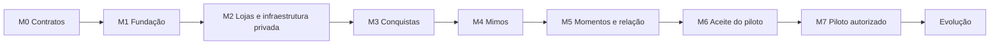

# Meu Mimo — roadmap de implementação

> **Para quem executar:** trabalhar por tarefas verificáveis, com um escritor por arquivo e revisão independente somente leitura. Usar os recursos nativos descobertos no cliente e as skills disponíveis; nenhuma instalação adicional é pressuposta. As caixas abaixo representam trabalho futuro.

**Objetivo:** transformar a prévia em uma aplicação privada que complete o ciclo criar loja → convidar → registrar conquista → analisar → pontuar → resgatar → realizar o mimo.

**Arquitetura:** preservar o protótipo como referência visual e implementar os fluxos reais por entregas completas. Autorização pertence ao servidor; pontos, estoque, tickets e notificações de domínio exigem persistência consistente. Prisma permanece responsável pelo acesso e pelas migrações do banco.

**Stack:** hoje, HTML/CSS/JavaScript ESM, Node.js 24 e npm. Next.js/React/TypeScript, Tailwind/shadcn, PostgreSQL/Supabase e Vercel são a base proposta em arquitetura, sujeita à decisão T00.

**Especificação:** [requisitos](../../../requisitos.md), [arquitetura](../../../arquitetura.md), [design](../../../design.md) e [README](../../../README.md). Operação e qualidade: [onboarding](../../onboarding.md), [setup](../../setup.md) e [quality](../../quality.md).

**Data:** 22/10/2026. **Estado:** proposta para revisão; implementação deste roadmap ainda não iniciada. O documento organiza as fontes canônicas, sem converter suas propostas em decisões aprovadas. Este pedido cobre planejamento; a execução será uma etapa posterior.

## 1. Ponto de partida e restrições

| Situação | Evidência e consequência |
| --- | --- |
| Prévia funcional da participante | `prototype/dist/` contém fontes manuais, assets, três abas, atividades, resgate, extrato e bilhete demonstrativos. Preservar essa referência. |
| Persistência de demonstração | `prototype/dist/model.js` usa `localStorage`, saldo inicial de 240 e dia em São Paulo. Esses dados e regras não migram para contas reais. |
| Fundação de qualidade existente | A raiz oferece lint, autoverificação das regras e sete testes com `node:test`. Não há build/typecheck, backend, schema Prisma ou serviços reais. |
| Decisões confirmadas | Mobile first, conta com papéis por contexto e várias lojas, Prisma, históricos no MVP, várias fotos/vídeos por resgate e intenção de retrospectiva futura. |
| Infraestrutura proposta | Provedores, mecanismo de login, versões e hospedagem ainda precisam de decisão. Não há autorização implícita para serviços pagos ou publicação. |

Restrições globais para todas as tarefas:

- Preservar alterações locais, os sete testes de domínio e `prototype/dist/` versionado.
- Manter Node.js `>=24.12.0 <25` e npm enquanto compatíveis com a stack que for escolhida. Mudanças exigem registro canônico e verificação.
- Prisma executa somente no servidor. Validar sessão, papel, loja, participação e estado em cada acesso privado, inclusive por link direto.
- Saldo pertence à participação em uma loja; não existe saldo global entre lojas. Pendências de aprovação não são saldo disponível.
- Preservar snapshots da ocasião e corrigir pontos por movimentos compensatórios vinculados; editar o catálogo não reescreve o passado.
- Segredos, `.env`, backups e relatórios sensíveis ficam fora do Git. Exemplos de configuração não contêm valores reais.
- Interface e documentos usam português claro; manter identidade, assets e atribuições existentes.
- Não instalar hooks, trocar ORM, cliente, modelo, autenticação do agente ou permissões para cumprir uma receita genérica.

## 2. Abordagem recomendada

| Abordagem | Consequência | Avaliação |
| --- | --- | --- |
| Evolução por fluxos completos, preservando a prévia | Cada marco entrega comportamento testável para os papéis envolvidos; interface e serviços evoluem juntos. | Recomendada: permite validar privacidade e consistência antes de ampliar o produto. |
| Construir todo o backend e depois todas as telas | Contratos podem ser organizados cedo, mas os fluxos reais e o uso móvel só aparecem no fim. | Possível, com maior risco de retrabalho de integração. |
| Estender a demonstração local até parecer um produto completo | Reaproveita rapidamente a navegação, mas exige substituir suas suposições sobre identidade, persistência e pontos. | Inadequada como fundação das garantias do produto real. |

Proposta de organização: criar a aplicação futura em `web/`, mantendo os comandos do protótipo. Esse caminho é uma escolha deste roadmap a confirmar em T00; não é um diretório já implementado. Se a organização mudar, atualizar os caminhos e as ondas antes de delegar.

O roadmap define marcos e pacotes de trabalho. Antes da execução de cada pacote, detalhar suas interfaces, nomes de testes e comandos para as versões efetivamente escolhidas. Não gerar agora código de uma stack ainda proposta.

## 3. Marcos de entrega

| Marco | Tarefas | Entrega demonstrável | Condição para avançar |
| --- | --- | --- | --- |
| M0 · Contratos | T00 | Decisões necessárias ao MVP registradas e base atual verificada | Nenhuma proposta necessária à próxima tarefa tratada como confirmação |
| M1 · Fundação | T01–T03 | Aplicação escolhida executável, conta, autorização e componentes acessíveis | Instalação e checks reais; acesso cruzado negado; prévia preservada |
| M2 · Lojas e infraestrutura privada | T04–T06 | Lojas, convites, contexto, conversa/notificações persistidas e mídia privada | Conta com vários contextos sem vazamento; upload e eventos com repetição segura |
| M3 · Conquistas | T07–T08 | Envio → análise → crédito → contestação/anulação → extrato | Crédito/estorno únicos, recorrência correta e histórico da ocasião |
| M4 · Mimos | T09–T10 | Catálogo → resgate → combinado → realização/cancelamento | Saldo/estoque/ticket consistentes e devolução única |
| M5 · Momentos e relação | T11–T12 | Álbum privado, bilhete, reações, mural e central de novidades | Fotos e vídeos privados, falhas recuperáveis e bilhete versionado |
| M6 · Pronto para piloto | T13–T14 | Administração mínima, revisão integrada, recuperação e aceite móvel | Todos os P0 cobertos; evidências e limitações registradas |
| M7 · Piloto autorizado | T15 | Publicação controlada, acompanhamento e recuperação operacional | Autorização correspondente, ambiente conferido e fluxo real validado |
| Evolução | E01–E04 | PWA, push, metas, métricas e retrospectiva | Priorizar com uso do piloto e decisões específicas |

M3 e M4 são marcos internos de validação. O MVP descrito nos requisitos só está completo após M6: álbum, interações, notificações no app e administração mínima continuam P0.

Não há prazo de entrega firmado. Capacidade da equipe, orçamento, serviços e políticas de mídia ainda não estão definidos. Estimar duração por marco após T00/T01, usando a primeira entrega integrada para calibrar; paralelismo não equivale a redução garantida de prazo.

## 4. Decisões que liberam o trabalho

T00 organiza estas decisões com o idealizador; as que não forem resolvidas bloqueiam somente as tarefas dependentes. Propostas dos documentos, como saldo zero inicial, convite de sete dias e saldo negativo por estorno, precisam continuar identificadas até confirmação.

| ID | Decisão a registrar na fonte responsável | Necessária antes de |
| --- | --- | --- |
| D01 | Stack, organização `web/`, versões compatíveis, provedor PostgreSQL/Auth/Storage, ambientes de desenvolvimento/teste e custo disponível. Consultar Context7 e documentação oficial antes de instalar. | T01–T02 |
| D02 | Login, recuperação/verificação da conta, retorno seguro ao convite e proteção/provisionamento administrativo sem autocadastro. | T02 |
| D03 | Catálogo/atividades compartilhados ou exclusivos; saldo inicial; validade/uso/revogação de convite; efeitos de pausa/encerramento. | T04, T07, T09 |
| D04 | Início da semana, retroatividade, estados que ocupam ocorrência, alteração de fuso e limites técnicos de texto/paginação/requisições. | T04–T08, conforme o recurso |
| D05 | Contestação após gasto, saldo negativo por estorno, reabertura e recomposição; preservar tickets emitidos conforme a regra aprovada. | T08 |
| D06 | Estoque no cancelamento, pedido recusado, disputa sobre realização e procedimento de suporte no piloto. | T09–T10 |
| D07 | Quantidade/tamanho/formato de fotos e vídeos, duração, miniaturas, orientação/remoção de localização, processamento e reprodução Android/iPhone. Fazer prova técnica com arquivos fictícios; armazenamento não garante conversão. | T06 |
| D08 | Retenção de mídia/histórico, órfãos, relações encerradas e tickets cancelados; tratamento de pedido de exportação/exclusão e histórico compartilhado. Fluxo completo de exclusão pode evoluir depois, mas o contrato de dados é P0. | T06, T11, T14 |
| D09 | Aparelhos/versões suportados, disponibilidade, limite de custo, tolerância de perda (RPO), prazo de recuperação (RTO) e operação do piloto. | T14–T15 |
| D10 | Periodicidade, elegibilidade, corte/fuso, regeneração e compartilhamento opcional da retrospectiva. | E04; não bloqueia o MVP |

Registrar decisões de produto em `requisitos.md`/`design.md` e decisões técnicas em `arquitetura.md`; comandos e evidências operacionais em `docs/onboarding.md`, `docs/setup.md` e `docs/quality.md`. O roadmap referencia essas fontes e não cria um contrato concorrente.

## 5. Pacotes de trabalho e verificação

Os caminhos abaixo são alvos propostos, relativos à raiz, e incluem testes do pacote. Cada tarefa tem um responsável pela escrita. Mudanças adicionais em configuração, dependências, esquema ou documentação canônica passam pelo orquestrador e são serializadas.

**Recursos padrão:** T04–T14 usam exclusivamente banco de teste `meumimo_tXX`, prefixo privado de arquivos `test/tXX/`, quando necessário, porta local `4310` e saída `web/.next/`, em série. Se o provedor exigir outro mecanismo, alocar projeto/schema/bucket de teste equivalente antes do despacho. Não usar produção, credenciais reais de pessoas ou portas ocupadas por outro trabalho. Fixtures são fictícias. T00/T01 definem como criar e limpar somente esses recursos de teste.

### T00 · Fechar contratos e preparar o primeiro marco

**Responsável:** orquestrador, com decisões do idealizador. **Depende de:** nenhuma.
**Arquivos:** `requisitos.md`, `arquitetura.md`, `design.md`, `docs/{setup,onboarding,quality}.md` e este roadmap. **Recursos:** leitura do checkout; sem serviços mutáveis.

- [ ] Conferir estado do checkout e `npm run check`; separar implementado, confirmado e proposto.
- [ ] Registrar D01–D09, ou a tarefa exata que permanece bloqueada; deixar D10 para evolução.
- [ ] Detalhar T01–T03 com versões, arquivos, interfaces e comandos reais; revisar a matriz de cobertura da seção 7.
- [ ] Verificar: fontes canônicas sem contradições, responsável por cada pendência e próximo pacote liberado com aceite verificável.

### T01 · Fundação executável e gates da nova aplicação

**Responsável:** fundação/integração. **Depende de:** T00 e D01.
**Arquivos:** `web/package*.json`, `web/{next.config.*,tsconfig.json,eslint.config.*,*.config.*,.env.example}`, `web/src/app/{layout.tsx,page.tsx}`, `web/tests/setup/**`, `package*.json`, `eslint.config.mjs`, `.gitignore`, `.github/workflows/quality.yml`, `docs/{setup,onboarding,quality}.md`, `README.md`. **Recursos:** instalação npm serial, porta `4301`, `web/.next/`; sem dados reais. A lista de configuração é refinada para os nomes concretos antes do despacho.

- [ ] Criar somente a aplicação e ferramentas necessárias à stack confirmada, mantendo prévia e comandos atuais acessíveis.
- [ ] Acrescentar scripts reais de lint/checagem de tipos/build e testes da aplicação; adaptar o gate às fronteiras servidor/navegador e a TS/TSX, preservando as três regras locais e limite de 350 linhas por arquivo de código.
- [ ] Preparar execução independente de T02/T03, inclusive saídas de build e fixtures, sem instalar um segundo catálogo de ferramentas.
- [ ] Verificar instalação reproduzível, página inicial utilizável, build e tipos da aplicação, lint sem warnings e os sete testes atuais. Documentar os comandos adicionados e refletir a instalação de `web/` no CI.

### T02 · Conta, esquema inicial e autorização por recurso

**Responsável:** backend/dados. **Depende de:** T01, D01–D02 e contratos de domínio necessários ao esquema.
**Arquivos:** `web/prisma/**`, `web/prisma.config.*`, `web/src/server/{db,auth,authorization,audit}/**`, `web/src/app/api/auth/**`, `web/tests/integration/{auth,authorization,migrations}/**`. **Recursos:** banco `meumimo_t02`, porta `4302`, saída `web/.next-t02/`; backend de identidade de teste isolado.

- [ ] Modelar o núcleo P0 e suas relações conforme arquitetura §4, com restrições e migrações revisadas; entidades futuras de retrospectiva não são necessárias agora. Evoluções posteriores do esquema continuam com um escritor por vez.
- [ ] Preparar a base histórica desde o MVP: identificadores estáveis, snapshots, origens e compensações; instantes em UTC e datas distintas de atividade, envio, aprovação, crédito, resgate, realização e estorno, apresentadas no fuso da loja.
- [ ] Implementar conta, sessão, recuperação e autorização reutilizável; contratos incluem conta, loja, participação, papel e estado. Negar administração por cadastro público.
- [ ] Verificar migração em banco vazio e evolução com dados fictícios; não recriar schemas internos de Auth/Storage. Conferir conexão/pooling e permissões efetivas do Prisma, Data API, Storage e Realtime quando aplicáveis.
- [ ] Testar chamadas diretas com usuário errado, outra loja, outro participante, sessão expirada e usuário comum tentando administrar. Validar recuperação/retorno de login sem redirecionamento indevido.

### T03 · Identidade visual e componentes acessíveis

**Responsável:** interface. **Depende de:** T01 e contrato visual existente.
**Arquivos:** `web/src/components/ui/**`, `web/src/styles/**`, `web/src/app/visual-check/**`, `web/public/assets/**`, `web/tests/ui/foundation/**`. **Recursos:** porta `4303`, saída `web/.next-t03/`, dados estáticos; nenhum banco/bucket.

- [ ] Reaproveitar assets/atribuições, tokens semânticos, DM Sans/DM Serif com alternativas, botões, formulários, estados e painéis com fechamento e foco corretos.
- [ ] Validar três composições: Lojinha, detalhe de mimo e resumo do lojista; separar pontos disponíveis de pendentes.
- [ ] Verificar 320 px, toque ≥44 × 44 px, texto a 200%, contraste, teclado, retorno/contenção de foco, leitor de tela e movimento reduzido. A página de conferência usa somente conteúdo fictício.

### T04 · Lojas, participantes, convites e navegação contextual

**Responsável:** fluxo de conta/loja. **Depende de:** T02, T03 e D03–D04 aplicáveis.
**Arquivos:** `web/src/server/{stores,memberships,invitations}/**`, `web/src/app/{conta,convites,lojas}/**`, `web/src/components/{navigation,stores}/**`, `web/tests/{integration,e2e}/stores/**`, `web/prisma/**` se necessário. **Recursos:** padrão T04; identidades de teste.

- [ ] Entregar C01–C03/C05, L01/L09–L11 e navegação por papel; uma conta cria e participa de várias lojas com busca/paginação.
- [ ] Aceitar convite preservando destino; tratar inválido, expirado, revogado, aceito, próprio lojista e participante já vinculado sem duplicação.
- [ ] Aplicar pausa/encerramento desde os serviços, preservando consulta e tratamento de pendências conforme contrato; limpar/isolar cache, rascunhos e preferências ao trocar conta/loja.
- [ ] Verificar conta com uma loja própria e duas participações; dois participantes da mesma loja; convite aberto via mensageiro; logout/login no mesmo aparelho sem dados anteriores.

### T05 · Conversas e notificações persistidas

**Responsável:** backend de relação. **Depende de:** T04.
**Arquivos:** `web/src/server/{conversations,notifications,outbox}/**`, `web/src/components/conversation/**`, `web/tests/integration/{conversations,notifications}/**`, `web/prisma/**`. **Recursos:** padrão T05; entrega de eventos exclusivamente de teste.

- [ ] Definir comentários por registro/ticket e audiência participante–lojista; habilitar a resposta à contestação nas próximas tarefas, sem criar chat coletivo.
- [ ] Persistir evento de domínio/outbox na mesma transação da mudança que origina uma novidade; entrega repetida não duplica a notificação. Realtime, se escolhido, apenas sinaliza nova consulta autorizada.
- [ ] Verificar autorização da conversa, deduplicação, falha/repetição de entrega e consulta que recupera evento perdido. Não enviar e-mail, push ou mensagens externas nesta tarefa.

### T06 · Mídia privada e prova de fotos/vídeos

**Responsável:** backend de mídia. **Depende de:** T05, D07–D08.
**Arquivos:** `web/src/server/media/**`, `web/src/components/media/**`, `web/tests/integration/media/**`, `web/tests/fixtures/media/**`, `web/prisma/**`; políticas de aplicação na cadeia de migrações. **Recursos:** padrão T06 e processamento de mídia de teste conforme decisão; sem mídia pessoal.

- [ ] Implementar autorização de upload/consulta, metadados, vínculos de propósito evidência/memória, estados por arquivo e limpeza de órfãos conforme retenção. Objetos ficam privados mesmo durante envio.
- [ ] Tratar orientação e metadados de localização nas imagens disponibilizadas; validar formatos/tamanhos e miniaturas. Testar vídeos nos aparelhos escolhidos e decidir processamento necessário antes de depender dele.
- [ ] Verificar câmera negada, galeria, upload interrompido/retomado com autorização revalidada, formato inválido, arquivo duplicado, URL expirada e acesso direto por outro participante. Conferir imagem, miniatura e reprodução privadas.

### T07 · Atividades e envio de conquistas com crédito consistente

**Responsável:** domínio de conquistas/pontos. **Depende de:** T06, D03–D04.
**Arquivos:** `web/src/server/{activities,submissions,points}/**`, `web/src/app/lojas/[storeId]/{atividades,registros}/**`, `web/src/components/activities/**`, `web/tests/{unit,integration,e2e}/activities/**`, `web/prisma/**`. **Recursos:** padrão T07.

- [ ] Entregar L03/L04 e P02–P04: cadastro/edição/arquivo, frequência única/diária/semanal, regra manual padrão ou automática, legenda e uma foto opcionais.
- [ ] Guardar pontuação/regra da ocasião; considerar data da atividade, envio e fuso da loja. Crédito automático, extrato e evento são consistentes; envio manual apenas cria pendência.
- [ ] Verificar limite por ocorrência, virada do dia/semana, aparelho em outro fuso, edição de regra após envio, toque duplo e tentativas simultâneas. Envio manual não aumenta saldo disponível; automático credita uma única vez.

### T08 · Análise, contestação, estorno e extrato

**Responsável:** domínio de conquistas/pontos. **Depende de:** T07 e D05.
**Arquivos:** `web/src/server/{submissions,points}/**`, `web/src/app/lojas/[storeId]/{registros,extrato}/**`, `web/src/components/{submissions,points}/**`, `web/tests/{integration,e2e}/points/**`, `web/prisma/**`. **Recursos:** padrão T08.

- [ ] Entregar L05/P05 e extrato: aprovar, contestar com motivo/resposta/complemento, manter, anular e reabrir preservando eventos anteriores.
- [ ] Diferenciar estado da análise e dos pontos. Contestar crédito existente não o remove; anulação/recomposição seguem D05, com compensação única e impacto claro antes de confirmar.
- [ ] Entregar filtros/paginação por período/tipo e origem autorizada do movimento, disponíveis pelo potinho e por Meus mimos. Separar ganhos, débitos, devoluções e compensações.
- [ ] Verificar aprovações/anulações simultâneas e repetidas, pontos já gastos, reabertura sem crédito duplicado, reconciliação do saldo com o extrato e histórico após renomear/arquivar atividade.

### T09 · Catálogo, resgate transacional e histórico de tickets

**Responsável:** domínio de mimos/pontos. **Depende de:** T08 e D06.
**Arquivos:** `web/src/server/{rewards,redemptions,points}/**`, `web/src/app/lojas/[storeId]/{mimos,tickets}/**`, `web/src/components/{rewards,tickets}/**`, `web/tests/{integration,e2e}/redemptions/**`, `web/prisma/**`. **Recursos:** padrão T09.

- [ ] Entregar L06/L07 e P06–P09: catálogo editável, categorias, recadinho, custo e disponibilidade; confirmação com custo/saldo restante e mensagem de quanto falta.
- [ ] Validar participação, loja, saldo e estoque; emitir ticket, débito, reserva e evento na mesma operação, com chave de repetição e estratégia de concorrência explícita.
- [ ] Preservar nome/custo/instruções da ocasião e histórico paginado por período/estado; contador de navegação considera somente tickets a realizar.
- [ ] Verificar dois resgates com saldo para um, disputa pelo último item entre participantes, resposta perdida após confirmação e edição/arquivamento posterior do mimo. Falha não deixa débito ou estoque reservado sem ticket.

### T10 · Combinado, realização e cancelamento

**Responsável:** domínio de tickets. **Depende de:** T09 e D06.
**Arquivos:** `web/src/server/{redemptions,points}/**`, `web/src/app/lojas/[storeId]/tickets/**`, `web/src/components/tickets/**`, `web/tests/{integration,e2e}/tickets/**`, `web/prisma/**`. **Recursos:** padrão T10.

- [ ] Entregar L08/P09 com conversa e linha do tempo: aguardando combinar, combinado, realizado, cancelamento solicitado e cancelado/estornado.
- [ ] Pedido em análise impede realização; recusa com motivo restaura estado anterior. Lojista pode iniciar cancelamento; estorno e eventual reposição de estoque obedecem ao contrato aprovado.
- [ ] Verificar realizar duas vezes, cancelar duas vezes, realizar concorrendo com cancelamento, tickets em loja pausada/relação encerrada e devolução que não conta como conquista. Tickets não expiram no MVP e realização não debita de novo.

### T11 · Álbum privado por ticket

**Responsável:** fluxo de momentos. **Depende de:** T10, T06 e D07–D08.
**Arquivos:** `web/src/server/albums/**`, `web/src/components/albums/**`, `web/src/app/lojas/[storeId]/tickets/**`, `web/tests/{integration,e2e}/albums/**`, `web/prisma/**`. **Recursos:** padrão T11 e pipeline de mídia de teste.

- [ ] Lojista seleciona/revisa/envia/publica várias fotos e vídeos; legenda/ordem, progresso, falha/tentativa por arquivo, publicação explícita dos prontos e novos lotes posteriores.
- [ ] Participante vê somente mídias publicadas no próprio ticket, com ampliação de fotos e player com controles, sem som automático. Remoção própria exige confirmação e respeita retenção.
- [ ] Verificar três fotos e dois vídeos, falha em um vídeo, retomada e nova tentativa sem duplicação; uma novidade agrupada por publicação. Outro ticket do mesmo mimo tem álbum independente.
- [ ] Confirmar que publicar/remover mídia ou adicionar depois da realização não muda pontos, estoque ou estado do ticket; acesso a arquivo/miniatura de outra participação é negado.

### T12 · Relação, novidades e telas iniciais completas

**Responsável:** fluxo de relação. **Depende de:** T11 e T05.
**Arquivos:** `web/src/server/{notes,reactions,notifications,dashboards}/**`, `web/src/components/{notes,reactions,feed,notifications,dashboards}/**`, `web/src/app/{notificacoes,lojas/[storeId]/pessoas,lojas/[storeId]/mural,lojas/[storeId]/resumo}/**`, `web/src/app/lojas/[storeId]/page.tsx`, `web/tests/{integration,e2e}/relationship/**`, `web/prisma/**`. **Recursos:** padrão T12.

- [ ] Entregar bilhete individual editável com versões/leitura entre dispositivos, coração e cartão; sem confirmação de leitura ao lojista. Recadinho do catálogo permanece distinto do bilhete privado.
- [ ] Completar reações/comentários e mural privado sobre registros/tickets, conforme design §15; reações não aprovam atividade nem realizam ticket.
- [ ] Entregar C04 e preferências: loja/autor/evento/leitura/destino, agrupamento de interações e autorização atual ao abrir outra loja. Uso não depende de push.
- [ ] Integrar L02 com checklist inicial, registros pendentes, mimos a realizar, participantes, acontecimentos recentes e atalhos, usando consultas autorizadas. Montar P01 completa com saudação, saldo/pendências, atividades, vitrine e bilhete da participação; substituir as composições fictícias de T03 por dados reais.
- [ ] Verificar loja vazia e em uso, contadores após aprovação/resgate/realização e troca de loja/papel. O resumo agrega somente a loja gerenciada; a Lojinha não revela saldos, bilhetes ou acontecimentos de outros participantes.
- [ ] Verificar abrir versão antiga durante envio de nova, troca de conta, item de outra loja, acesso revogado e perda de Realtime seguida de nova consulta. Nenhum participante acessa bilhete/mural alheio.

### T13 · Administração mínima e diagnóstico

**Responsável:** operação da plataforma. **Depende de:** T12 e D02/D09 aplicáveis.
**Arquivos:** `web/src/server/admin/**`, `web/src/app/admin/**`, `web/tests/{integration,e2e}/admin/**`, `web/src/server/audit/**`, `web/prisma/**`. **Recursos:** padrão T13; conta administrativa fictícia provisionada pelo procedimento aprovado.

- [ ] Entregar A01–A04: contagens, busca/listas de contas e lojas, detalhe de metadados e pausa/reativação com motivo, alcance e auditoria.
- [ ] Verificar ausência de promoção por autocadastro, tentativa de administrar como usuário comum e ações auditadas; administrador não ganha acesso cotidiano a fotos, pontos, análises ou tickets privados.
- [ ] Conferir logs úteis para falhas/decisões, sem tokens, arquivos ou conteúdo de conversas; distinguir suspensão operacional de bloqueio de segurança conforme contrato.

### T14 · Aceite integrado e recuperação antes do piloto

**Responsável:** orquestrador/QA, com revisões independentes de segurança e UI somente leitura. **Depende de:** T13 e D08–D09.
**Arquivos:** `web/tests/e2e/pilot/**`, `docs/{quality,onboarding,setup}.md`, `docs/pilot/**`, configurações de CI afetadas. **Recursos:** padrão T14; cópia descartável de banco/arquivos para restauração; Android/iPhone da matriz. Relatórios sensíveis ficam fora do Git.

- [ ] Executar o ciclo completo com lojista, dois participantes e conta que alterna papéis/lojas; cobrir todos os cenários P0 da seção 5 de requisitos.
- [ ] Revisar caminhos efetivos de Prisma, Data API, Storage e Realtime; repetir operações concorrentes, timeout após confirmação, sessões expiradas e isolamento de caches.
- [ ] Conferir tarefas dos três papéis no celular: 320 px sem rolagem horizontal, toque ≥44 px, texto 200%, teclado/foco/leitor de tela, estados vazios/erro, movimento reduzido, áreas seguras, câmera/galeria, autenticação e convite via mensageiro.
- [ ] Medir desempenho em laboratório com mídia representativa e preparar medição móvel real: metas de p75 LCP ≤2,5 s, INP ≤200 ms e CLS ≤0,1. Laboratório não comprova percentil de tráfego real.
- [ ] Restaurar banco e arquivos em ambiente separado; verificar RPO/RTO, permissões, compatibilidade de migrações com dados existentes e recuperação de publicação com falha.
- [ ] Executar os checks documentados, resolver achados confirmados e registrar evidências/limitações. Aprovar o marco somente com os P0 cobertos; ausência de dispositivo ou serviço de teste fica como pendência explícita.

### T15 · Publicação e piloto controlado

**Responsável:** orquestrador/operação. **Depende de:** T14 e autorização de publicação, serviços/custo e migrações reais.
**Arquivos:** configuração do provedor escolhido, `docs/pilot/**`, `docs/{setup,onboarding,quality}.md`. **Recursos:** ambientes nomeados e autorizados, secrets no serviço apropriado; ações serializadas.

- [ ] Preparar versão revisável, variáveis por ambiente, migrações revisadas, backup/recuperação e checklist operacional concreto antes da autorização final de publicação.
- [ ] Com a autorização correspondente, aplicar o procedimento aprovado, verificar saúde e executar o ciclo com contas de piloto autorizadas, sem importar estado da demonstração.
- [ ] Acompanhar falhas, entregas pendentes e metas com o volume disponível; registrar limitações de amostra. Priorizar correções e evolução com evidência de uso.

## 6. Orquestração por ondas

Referência aplicada: [planejamento, prompt 04](https://github.com/soumatheusgomes/vibe-coding-toolkit/blob/790a895304e0c08b70a5b215c9d334f1c86b816c/docs/prompts/04-brainstorm-to-plan.md), [ondas paralelas, prompt 05](https://github.com/soumatheusgomes/vibe-coding-toolkit/blob/790a895304e0c08b70a5b215c9d334f1c86b816c/docs/prompts/05-parallel-wave-dispatch.md) e [guia de orquestração](https://github.com/soumatheusgomes/vibe-coding-toolkit/blob/790a895304e0c08b70a5b215c9d334f1c86b816c/docs/tools/02-subagent-orchestration.md), na revisão já adotada pelo projeto. Planejamento e revisão foram feitos com recursos nativos, preservando modelo e permissões da sessão.

| Onda | Tarefas e responsáveis | Regra de integração |
| --- | --- | --- |
| 0 | T00 · orquestrador | Consolidar decisões e contratos |
| 1 | T01 · fundação | Um escritor para dependências/configuração/CI |
| 2 | T02 · backend/dados; T03 · interface | Paralelo somente com arquivos e recursos isolados descritos nos pacotes e verificados em T01 |
| 3 | T04 · conta/loja | Integrar identidade, contexto e navegação |
| 4 | T05 · relação | Definir conversa e eventos que o domínio consumirá |
| 5 | T06 · mídia | Provar privacidade e pipeline antes de usar arquivos nos registros |
| 6 | T07 · conquistas/pontos | Cadastro, envio e crédito automático |
| 7 | T08 · conquistas/pontos | Análise, compensação e extrato |
| 8 | T09 · mimos/pontos | Resgate usa o contrato estável da carteira |
| 9 | T10 · tickets | Fechar realização/cancelamento antes do álbum |
| 10 | T11 · momentos | Integrar mídia, ticket e notificação agrupada |
| 11 | T12 · relação | Completar bilhete, mural, central, Lojinha e resumo do lojista |
| 12 | T13 · operação | Administração mínima |
| 13 | T14 · integração/QA | Revisões somente leitura podem ocorrer em paralelo; checks com recursos compartilhados ficam em série |
| 14 | T15 · operação | Somente após autorização correspondente |

O backend de T02 não consome componentes de T03; a interface de T03 usa fixtures e não consome os serviços em construção. Ambos dependem dos contratos/configuração de T01. Se essa separação ou o isolamento de build/identidade não estiver comprovado, executar T02 e T03 em série. Alteração de arquivo compartilhado nunca é exceção para manter uma onda paralela.

Para cada despacho: informar objetivo, fontes, arquivos permitidos, dependências, recursos concretos, aceite e comandos. Se arquivos/recursos/dependências ainda forem incertos, considerar dependência de tudo que já foi listado e serializar até esclarecer.

Implementadores verificam e relatam arquivos/contratos alterados; não fazem commits. O orquestrador confere integração e somente ele opera Git quando autorizado. Sem commits, revisar arquivos atuais e snapshots registrados; não inventar `HEAD` ou base de PR. Revisores não editam, não aplicam correções automáticas e não criam novos revisores. Só avançar depois de verificar a onda e tratar os achados confirmados.

## 7. Rastreabilidade e foco de revisão

| Requisitos funcionais | Pacotes responsáveis |
| --- | --- |
| RF-01, RF-02 | T02, T04, T13 |
| RF-03, RF-04, RF-19 | T04, T10, T14 |
| RF-05, RF-06, RF-08, RF-17 | T06–T08 |
| RF-07, RF-09 | T05, T08 |
| RF-10, RF-11, RF-23 | T09–T10 |
| RF-12 | T10 |
| RF-13 | T05, T10, T12 |
| RF-14, RF-15 | T05, T12 |
| RF-16 | T03–T04, T07–T09, T12 |
| RF-18 | T02 e todos os serviços privados; validação integrada T14 |
| RF-20 | T13 |
| RF-25, RF-26 | T06, T11–T12 |
| RF-21, RF-22, RF-24 · P1 | E01, E02, E04 |

| Requisitos não funcionais | Pacotes responsáveis |
| --- | --- |
| RNF-01, RNF-07, RNF-09 | T03, cada fluxo com UI, T14 |
| RNF-02, RNF-10 | T02, T04, T06, T12–T14 |
| RNF-03, RNF-04 | T02, T05, T07–T11 |
| RNF-05, RNF-20, RNF-21 | T06, T11, T14 |
| RNF-06 | T04, T06–T12, T14 |
| RNF-08 | T03, T06, T14–T15 |
| RNF-11 | T02 e tarefas de domínio, T13–T14 |
| RNF-12, RNF-13 | T00–T02, T14–T15 |
| RNF-14, RNF-16 | T00/D04/D07/D08, T04–T12, T14 |
| RNF-18, RNF-19 | T02, T07–T11, T14 |
| RNF-15, RNF-17 · P1 | E01, E03 |

Cinco situações prioritárias para revisão independente; os testes pertencem aos pacotes indicados:

1. Sessão válida tentando abrir arquivo, registro ou ticket de outra relação: negar também o acesso direto, miniatura e canal de atualização (T02/T06/T11/T14).
2. Resposta perdida depois de crédito/resgate/cancelamento confirmado: recuperar resultado com a mesma identificação sem repetir efeitos (T07–T10).
3. Virada do período, alteração de regra e anulação após gasto: preservar ocorrência, regra histórica e saldo reconciliável conforme contrato (T07–T08).
4. Publicação parcial e retomada de vídeo após perda de acesso: preservar itens prontos, revalidar autorização e não duplicar mídia/aviso (T06/T11).
5. Nova versão de bilhete chegando enquanto a anterior é aberta, seguida de troca de conta: manter leitura por versão e impedir conteúdo residual (T04/T12).

## 8. Evolução após o piloto

| ID | Entrega proposta | Dependências e aceite |
| --- | --- | --- |
| E01 | PWA e push opcionais | T15; definir cache/atualização/descarte por conta e loja, pedir permissão no contexto, respeitar preferências e abrir destino autorizado. Navegador continua funcional sem instalação ou push. |
| E02 | Meta de mimo | T15; escolha por participação com progresso de saldo daquela loja, sem impedir resgate de outros mimos. |
| E03 | Métricas de produto | T15 e política de coleta; medir criação de loja, aceite, primeiro registro/aprovação/resgate/realização sem coletar textos, fotos ou vídeos. Distinguir das medições de desempenho P0. |
| E04 | Retrospectiva mobile | T15, D10 e base histórica já capturada; métricas por participação, período, fuso, corte e versão, com cancelamentos/compensações corretos. Reembolso não vira conquista; resgate não implica realização. Seleção e prévia explícitas antes de compartilhar mídia/bilhetes. |

Planos/cobrança, colaboradores, transferência, múltiplas fotos por registro de atividade, suporte privado completo, exclusão de conta com automação completa, temas e recursos nativos exigem priorização própria. Não criar sistemas genéricos de analytics ou eventos para antecipar essas possibilidades.

## 9. Evidências deste planejamento e próximo passo

- Leitura das fontes canônicas e conferência dos scripts, regras, workflow, modelo e sete testes do protótipo.
- Duas análises independentes somente leitura: cobertura de produto/design e dependências/riscos técnicos. A revisão final de consistência identificou a falta de responsável pela integração real de L02; T12 passou a incluir o resumo do lojista e a Lojinha completa, com arquivos e critérios de contexto.
- `npm run check` executado em 22/10/2026: três regras locais verificadas, lint sem erros/warnings e 7/7 testes aprovados. Isso verifica a base atual; não comprova os serviços futuros.
- Skill local do Vibe Coding Toolkit descoberta no cliente e consultada, com os fluxos de planejamento/orquestração; skills locais de planejamento, brainstorming, revisão e verificação usadas de forma proporcional ao pedido documental.
- Nenhum pacote da aplicação, provedor ou API teve sua versão escolhida neste planejamento. Context7 está descoberto nesta sessão; consultas de APIs/versões cabem a D01 antes de instalação, com documentação oficial como referência. O registro histórico de indisponibilidade em `docs/setup.md` não substitui essa descoberta atual.

Próximo passo de execução: T00, começando por D01/D02 e pelas políticas que liberam a fundação. Preparar as decisões e o plano detalhado da primeira onda para revisão antes de alterar código de produto. A revisão deste roadmap não autoriza por si só publicação, cobrança ou migração em ambiente real.
